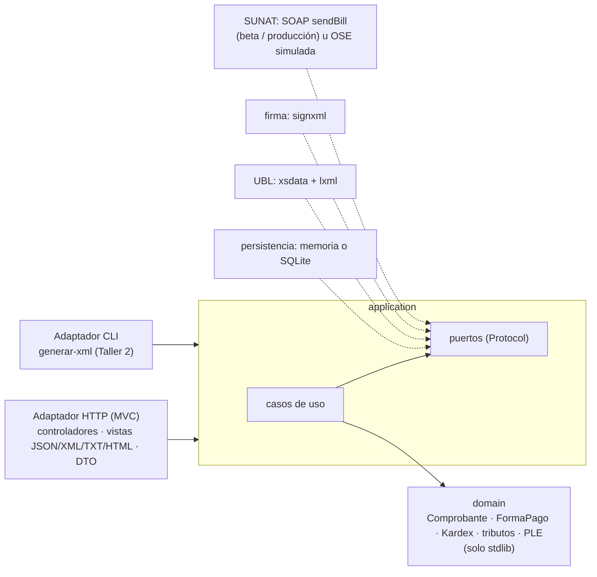

# ABC Software Corp: facturación electrónica UBL 2.1 e inventario permanente

**Universidad Nacional Agraria de la Selva** · Facultad de Ingeniería en Informática y Sistemas
**Curso:** Arquitectura de Software · **Grupo:** "A"
**Alumno:** Melor Smith Yanac Osorio
**Fase 1 (Spec-First):** examen de medio curso, 19/10/2026 · **Taller 2 (segundo parcial):** generación del XML y formulario de venta, 12/11/2026

[](https://github.com/Melor-Smith/ARQUITECTURA/actions/workflows/ci.yml) [](LICENSE)

## Ver el Taller 2 en un minuto

| Qué | Cómo |
|---|---|
| **Abrir la interfaz** "Registrar venta" | **Doble clic en [`iniciar.bat`](iniciar.bat)** (Windows) o `python iniciar.py` (cualquier sistema). Solo requiere Python 3.10 o superior: la primera vez instala las dependencias (alrededor de un minuto), levanta el servidor y abre el navegador en `http://127.0.0.1:8000/venta` |
| **Generar el XML** | El formulario trae cargada la venta del caso (una motocicleta de S/ 5 000.00). Pulsar **Generar XML**: se ven los importes, la matriz "dato SUNAT → etiqueta UBL" y el XML sin firma, validado contra `UBL-Invoice-2.1.xsd` |
| **Validarlo en Nubefact** | **Copiar XML** → pegarlo en <https://probar-xml.nubefact.com/> → destino **OSE**, marcar **Firmar** y pulsar **Enviar** (sin pulsar *BeautifyXML*) → CDR 0, "ha sido ACEPTADA". [Evidencia](docs/evidencia-nubefact/README.md) |
| **Pruebas unitarias de generación** | `pip install -r requirements-dev.txt` y luego `pytest tests/unit/generacion_xml -v` |
| **El caso y la explicación** | [`docs/TALLER-2-generacion-xml.md`](docs/TALLER-2-generacion-xml.md) |

## Guía del evaluador

| Lo que pide el enunciado | Dónde verlo (en orden de lectura) |
|---|---|
| 1. Modelo de dominio y contratos | [`specs/domain/modelo-dominio.md`](specs/domain/modelo-dominio.md) → [diagrama 06 de clases](docs/diagramas/06-clases-dominio.svg) → [`specs/contracts/schemas/`](specs/contracts/schemas) (JSON Schemas escritos a mano) |
| 2. Diagramas MVC con visión hexagonal | [`docs/diagramas/`](docs/diagramas): [03 MVC](docs/diagramas/03-mvc-actual.svg) · [04 hexagonal](docs/diagramas/04-hexagonal.svg) · [05 evolución](docs/diagramas/05-evolucion.svg) → [`specs/architecture/arquitectura.md`](specs/architecture/arquitectura.md) |
| 3. Contratos API (Spec-First) | [`specs/contracts/openapi.yaml`](specs/contracts/openapi.yaml) → [`specs/ejemplos/`](specs/ejemplos) → [`invalidos/`](specs/ejemplos/invalidos) · decisión en el [ADR 0013](specs/adr/0013-contrato-escrito-primero-y-verificado-contra-el-codigo.md) |
| 4. Matriz de trazabilidad SUNAT ↔ UBL | [`specs/traceability/matriz-trazabilidad.md`](specs/traceability/matriz-trazabilidad.md) |
| Taller 2 (segundo parcial) | [`docs/TALLER-2-generacion-xml.md`](docs/TALLER-2-generacion-xml.md) (el caso y el formulario) → formulario **`http://localhost:8000/venta`** → [`tests/unit/generacion_xml/`](tests/unit/generacion_xml) → [evidencia de Nubefact](docs/evidencia-nubefact/README.md) |
| Informe consolidado | [`entregable/Informe-ABC-SpecFirst.pdf`](entregable/Informe-ABC-SpecFirst.pdf) (y `.docx`) |
| Extras (fuera del enunciado) | SUNAT beta ([evidencia](docs/evidencia-sunat/README.md)), OSE-DEMO de Nubefact ([evidencia](docs/evidencia-nubefact/README.md)), PLE ([evidencia](docs/evidencia-ple/README.md)), SQLite, Docker, prototipo MSI ([ADR 0008](specs/adr/0008-distribucion-msi-y-apk.md)) |

## Cronología de entregas

| Fecha | Qué se entregó | Versión |
|---|---|---|
| 22/10/2026 | **Fase 1 (Spec-First)** del examen de medio curso, evaluada con 38/100 | commits `954bbb2` a `6e77748` |
| 05/11/2026 | Corrección completa de las observaciones, **Taller 2** (generación del XML), PLE y envío a SUNAT beta | commits `0ded039` a `46b375e` · detalle en [`docs/CORRECCIONES.md`](docs/CORRECCIONES.md) |
| 12/11/2026 | **Taller 2 (segundo parcial):** descripción del caso, formulario "Registrar venta" que genera el XML sin firma y prueba en el OSE-DEMO de Nubefact | [`TALLER-2-generacion-xml.md`](docs/TALLER-2-generacion-xml.md) · [evidencia de Nubefact](docs/evidencia-nubefact/README.md) |
| 05/11/2026 | **Cuarta iteración:** contrato escrito primero, diagramas renderizados, informe PDF, ADR 0008 decidido, seguridad de tokens | commits posteriores a `46b375e` · [`CORRECCIONES.md`, cuarta iteración](docs/CORRECCIONES.md#cuarta-iteración-metodología-presentación-y-seguridad-revisión-del-0511) |

**La versión válida es la rama `main`.** La rama `codigo-completo` conserva la entrega del 22/10 tal como se presentó; no tiene cambios posteriores.

## Qué hace el sistema

API y núcleo de negocio para **ABC Software Corp**, distribuidora de abarrotes:

- **Comprobantes electrónicos SUNAT:** factura (01), boleta (03), nota de crédito (07) y nota de débito (08), al contado o al crédito con cuotas.
  - IGV, ISC (Catálogo 08) e ICBPER calculados en el dominio con `Decimal`.
  - Correlativo atómico.
  - **XML generado desde las clases del XSD OASIS UBL 2.1**, validado, firmado (XMLDSig) y enviado a SUNAT por SOAP `sendBill`; el estado sale del CDR.
  - los **7 comprobantes del caso fueron aceptados por el servicio beta de SUNAT** (CDR código 0, [evidencia](docs/evidencia-sunat/README.md)).
- **Migración del sistema antiguo** (`fecha`, `ingreso`, `salida`, `producto`, `nro_documento`) al inventario permanente de la RS 234-2006, ficha por ficha o por lotes, con observaciones y conciliación.
- **Libros electrónicos PLE 14.1** (Registro de Ventas) **y 12.1** (Inventario en unidades físicas):
  - estructura verificada campo por campo contra el **Excel oficial del Anexo 2** (PLE 5.0);
  - nunca se entrega un TXT que el PLE rechazaría;
  - el 12.1 generado pasó el **programa PLE 5.2.0.7 de SUNAT sin inconsistencias** ([constancia](docs/evidencia-ple/README.md)).

| Documento | Para quién |
|---|---|
| **[`docs/TALLER-2-generacion-xml.md`](docs/TALLER-2-generacion-xml.md)** | **Taller 2 (segundo parcial):** generación del XML desde `UBL-Invoice-2.1.xsd` en el lenguaje del dominio y sus pruebas unitarias |
| **[`docs/CORRECCIONES.md`](docs/CORRECCIONES.md)** | Revisión del primer entregable (38/100): cada observación, su corrección y la prueba que la demuestra |

## Calidad verificable

Cada número sale de una herramienta que corre en la [CI](.github/workflows/ci.yml) en cada cambio, no de una afirmación:

| Verificación | Resultado | Cómo comprobarlo |
|---|---|---|
| Pruebas automáticas | **944**, en Python 3.10, 3.12 y 3.13 | `pytest -q` |
| Cobertura del código propio (sin las clases generadas del XSD) | **97 %**, con mínimo exigido del 90 % | `pytest --cov` |
| Tipado estático | **0 errores** en 70 archivos | `mypy` |
| Estilo y errores comunes | **0 avisos** | `ruff check .` |
| Vulnerabilidades en dependencias | **0 conocidas** | `pip-audit -r requirements.txt` |
| Regla de dependencias hexagonal | Verificada por prueba | `tests/integration/test_arquitectura.py` |
| Intercambio de adaptadores | Las pruebas de API corren contra **memoria y SQLite** con el mismo resultado | `tests/conftest.py` (fixture `persistencia`) |
| Contrato escrito primero; el código lo implementa | Rutas, códigos HTTP, campos, catálogos y límites comparados en cada CI | `tests/acceptance/test_contrato.py` · `python scripts/exportar_openapi.py` |
| XML contra los XSD oficiales OASIS | Cada XML generado se valida antes y después de firmar | `tests/unit/generacion_xml/` |
| XML aceptado por SUNAT | **7 de 7 con CDR código 0** en el servicio beta; la evidencia se re-verifica sin red en cada CI y en vivo cada semana | [`docs/evidencia-sunat/`](docs/evidencia-sunat/README.md) · workflow `sunat-beta` |
| TXT del PLE contra la fuente oficial | Estructura comparada con el Excel del Anexo 2; **12.1 validado por el programa PLE de SUNAT**; cada fila del 14.1 cuadra con el XML que SUNAT aceptó | [`docs/evidencia-ple/`](docs/evidencia-ple/README.md) |
| Imagen Docker | Se construye, levanta, emite una factura (201) y no corre como root | job `contenedor` de la CI |

## Entregables

| # | Entregable | Dónde |
|:-:|---|---|
| 1 | Análisis del caso, normativa y casos de uso | [`docs/analisis/`](docs/analisis): [brechas y riesgos](docs/analisis/01-caso-brechas-y-riesgos.md) · [marco normativo y estudio del XSD](docs/analisis/02-marco-normativo.md) · [casos de uso](docs/analisis/03-casos-de-uso.md) · [atributos de calidad](docs/analisis/04-atributos-de-calidad.md) |
| 2 | Modelo de dominio y DTOs | [`src/domain/`](src/domain) (sin dependencias externas) · [`specs/domain/modelo-dominio.md`](specs/domain/modelo-dominio.md) · DTO en [`esquemas.py`](src/adapters/inbound/http/esquemas.py) |
| 3 | Arquitectura MVC → Hexagonal | [`specs/architecture/arquitectura.md`](specs/architecture/arquitectura.md) · [9 diagramas](docs/diagramas) · [`specs/adr/`](specs/adr) (0001-0014) · reglas verificadas en [`test_arquitectura.py`](tests/integration/test_arquitectura.py) |
| 4 | Contrato API | [`specs/contracts/openapi.yaml`](specs/contracts/openapi.yaml) y [`schemas/`](specs/contracts/schemas) (**escritos primero**; el código se verifica contra ellos) · Swagger en `/docs` · [ejemplos](specs/ejemplos) y [contraejemplos](specs/ejemplos/invalidos) |
| 5 | Matriz de trazabilidad | [`specs/traceability/matriz-trazabilidad.md`](specs/traceability/matriz-trazabilidad.md) y [`matriz.csv`](specs/traceability/matriz.csv): 72 filas, cardinalidad **calculada del XSD**, 64 XPath **verificados contra XML reales**; las columnas PLE 14.1 / 12.1 y de contrato también se verifican (Anexo 2, TXT generado y OpenAPI), así que ninguna fila queda sin ubicación comprobada · [`specs/ple/`](specs/ple) (con el [Anexo 2 oficial](specs/ple/anexo2)) |
| 6 | Pruebas y evidencia | [`tests/`](tests) (944 pruebas) · [`docs/ejemplos/`](docs/ejemplos) (XML firmados, respuestas y TXT del PLE **generados por el sistema**) |

## Arquitectura en una imagen



```
src/
├── domain/          entidades, objetos de valor, reglas SUNAT, forma de pago, Kardex, filas y estructura PLE (solo stdlib)
├── application/     casos de uso + puertos (typing.Protocol) + comandos
├── adapters/
│   ├── inbound/     http/ (FastAPI: controladores, vistas, DTO, problem+json, seguridad) · cli.py · traduccion.py
│   └── outbound/    persistencia (memoria y SQLite), ubl (generador xsdata + generated/ + validador), firma (signxml), ose (SUNAT SOAP y simulada), reloj
├── bootstrap.py     raíz de composición (único lugar que conoce las clases concretas)
├── config.py        configuración por variables de entorno
└── main.py          app ASGI
```

## Probarlo en un minuto (Docker)

```bash
docker build -t abc-facturacion .
docker run --rm -p 8000:8000 -v abc-datos:/datos abc-facturacion   # http://localhost:8000/docs  (token: dev-facturador)
```

## Instalación y ejecución (Python 3.10 o superior)

```powershell
python -m venv .venv
.venv\Scripts\Activate.ps1          # Linux/macOS: source .venv/bin/activate
pip install -r requirements-dev.txt

pytest -q --cov                     # 944 pruebas + cobertura
pytest tests/unit/generacion_xml -v # solo las pruebas del Taller 2
ruff check . && mypy                # estilo y tipos

uvicorn src.main:app --reload       # http://localhost:8000/venta (formulario del Taller 2) · /docs (API)

# Taller 2: generar XML firmados sin levantar el servidor
python -m src.adapters.inbound.cli generar-xml specs/ejemplos/factura.json specs/ejemplos/factura-credito.json --fecha 2026-10-22
```

Tokens de **desarrollo**, públicos. En producción `ABC_API_TOKENS` es **obligatoria**: la configuración se niega a arrancar con cualquier token `dev-*`.

| Token | Alcances |
|---|---|
| `dev-facturador` | todos |
| `dev-almacen` | `inventario:escribir`, `inventario:leer` |
| `dev-consulta` | `comprobantes:leer`, `inventario:leer`, `libros:leer` |

### Variables de entorno

| Variable | Valor por defecto | Uso |
|---|---|---|
| `ABC_MODO_OSE` | `NORMAL` | `NORMAL`, `CAIDA`, `RESPUESTA_INVALIDA` o `RECHAZO`, para probar los caminos 201, 202, 502 y 503 |
| `ABC_PLAZO_ENVIO_DIAS` | `3` | Antigüedad máxima de la fecha de emisión |
| `ABC_API_TOKENS` | tokens `dev-*` (solo desarrollo y beta) | JSON `{"token": ["alcance", ...]}`. **Obligatoria en producción**: sin ella, o con un token `dev-*`, el servicio no arranca |
| `ABC_CERTIFICADO_PFX` / `ABC_CERTIFICADO_CONTRASENA` | autofirmado en memoria | Certificado digital del emisor (nunca se versiona) |
| `ABC_SUNAT_ENDPOINT` | sin valor: OSE simulada | `beta` (servicio de pruebas de SUNAT), `produccion` o una URL `billService` ([ADR 0012](specs/adr/0012-envio-real-a-sunat-y-validacion-contra-el-servicio-beta.md)) |
| `ABC_SUNAT_USUARIO_SOL` / `ABC_SUNAT_CLAVE_SOL` | `MODDATOS` / `moddatos` (beta) | Usuario SOL secundario; producción exige uno real y el certificado `ABC_CERTIFICADO_PFX` |
| `ABC_BASE_DATOS` | sin valor: memoria · Docker: `/datos/abc.db` | Archivo SQLite; los datos sobreviven a reinicios ([ADR 0011](specs/adr/0011-persistencia-sqlite-como-segundo-adaptador.md)) |

## Endpoints

| Método | Ruta | Respuestas |
|---|---|---|
| `POST` | `/api/v1/comprobantes` | 201 (CDR) · 202 (OSE caída) · 200 (idempotente) · 400 · 401 · 403 · 409 · 422 |
| `GET` | `/api/v1/comprobantes/{tipo}/{serie_numero}` | 200 · 400 · 401 · 403 · 404 |
| `GET` | `/api/v1/comprobantes/{tipo}/{serie_numero}/xml` | 200 `application/xml` (UBL firmado) |
| `POST` | `/api/v1/comprobantes/{tipo}/{serie_numero}/envios` | 200 · 404 · 409 · 502 · 503 (`Retry-After`) |
| `POST` | `/api/v1/inventario/migraciones` | 201 · 400 · 409 · 422 |
| `POST` | `/api/v1/inventario/migraciones/lotes` | 201 (resumen, observaciones y conciliación) · 400 |
| `GET` | `/api/v1/inventario/migraciones/{clave}` · `/migraciones/lotes/{id}` | 200 · 404 |
| `GET` | `/api/v1/inventario/kardex/{codigo_producto}` | 200 (con saldo final) · 404 |
| `GET` | `/api/v1/libros-electronicos/registro-ventas/{AAAAMM}` | 200 TXT del PLE 14.1 (`?formato=json`) · 422 `ERR-PLE-ESTRUCTURA` |
| `GET` | `/api/v1/libros-electronicos/inventario-unidades-fisicas/{AAAAMM}` | 200 TXT del PLE 12.1 (`?formato=json`) · 422 `ERR-PLE-ESTRUCTURA` |
| `GET` | `/salud` | 200 |

**Planificadas** (contrato escrito con `x-estado: planificado`, sin implementar; [ADR 0014](specs/adr/0014-comunicacion-de-baja-y-resumen-diario.md)): `POST /api/v1/comprobantes/{tipo}/{serie_numero}/bajas`, `GET /api/v1/bajas/{id}`, `POST /api/v1/resumenes-diarios` y `GET /api/v1/resumenes-diarios/{id}`, todas con respuesta 202 + ticket de SUNAT.

Todos los errores usan `application/problem+json` (RFC 9457) con un `codigo` estable: **400** si la solicitud no cumple el contrato y **422** si viola una regla de negocio.

## Scripts

| Script | Para qué |
|---|---|
| `python scripts/exportar_openapi.py` | **Compara** el contrato escrito a mano con lo que implementa el código y lista las diferencias (`--guardar` deja el OpenAPI del código en `build/`) |
| `scripts/renderizar_diagramas.ps1` / `.sh` | Renderiza `docs/diagramas/*.mmd` a `.svg` y `.png` (Mermaid CLI 11.4.2) |
| `python scripts/generar_informe.py` | Arma `entregable/Informe-ABC-SpecFirst.pdf` y `.docx` desde el repositorio |
| `python scripts/matriz.py` | Regenera la matriz (MD + CSV) desde `matriz.yaml`, calculando la cardinalidad desde los XSD |
| `python scripts/generar_ejemplos.py` | Regenera `docs/ejemplos/` con salidas reales (XML firmado, JSON, TXT del PLE) |
| `python scripts/preparar_validacion_ple.py` | Regenera `docs/evidencia-ple/paquete/`, los archivos para validar con el programa PLE de SUNAT |
| `python scripts/validar_en_sunat_beta.py` | Envía los 7 comprobantes del caso al servicio beta de SUNAT y guarda los CDR en `docs/evidencia-sunat/` (requiere internet) |
| `scripts/generar_clases_ubl.ps1` / `.sh` | Regenera las clases xsdata desde los XSD oficiales |

Hay una prueba por cada artefacto generado que falla si quedó desactualizado.

## Límites conocidos

- El envío a SUNAT se probó en el **servicio beta** (sin efecto tributario). Producción usa el mismo adaptador, pero exige certificado digital y usuario SOL reales; sin ellos la configuración no arranca.
- Las boletas se envían una por una (`sendBill`), lo que SUNAT admite. La comunicación de baja y el resumen diario (`sendSummary`) tienen el **contrato escrito**, pero no la implementación ([ADR 0014](specs/adr/0014-comunicacion-de-baja-y-resumen-diario.md)).
- La persistencia es en memoria o SQLite (un servidor). Para varios servidores, los mismos puertos sobre PostgreSQL.
- La estructura de los TXT del PLE se verifica contra el Excel oficial del Anexo 2 ([ADR 0010](specs/adr/0010-estructura-ple-en-el-dominio-validada-contra-el-anexo-2.md)). El 12.1 pasó además el programa PLE de SUNAT; el estado del 14.1 está en [`docs/evidencia-ple/`](docs/evidencia-ple/README.md).

Detalle y plan de producción en [`docs/CORRECCIONES.md`](docs/CORRECCIONES.md#límites-declarados) y en los ADR 0002, 0004, 0009, 0010, 0011, 0012 y 0014.

## Licencia

Código bajo [licencia MIT](LICENSE) © 2026 Melor Smith. Los XSD de OASIS y los documentos de SUNAT incluidos conservan sus propias condiciones: ver [`NOTICE.md`](NOTICE.md).
