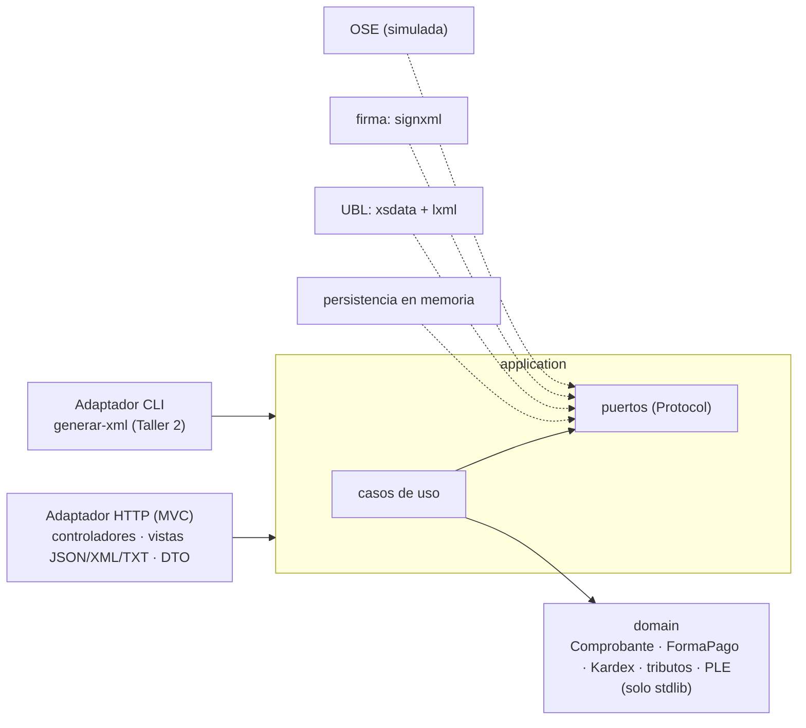

# ABC Software Corp: facturación electrónica UBL 2.1 e inventario permanente

API y núcleo de negocio para **ABC Software Corp**, distribuidora de abarrotes:

- **Comprobantes electrónicos SUNAT:** factura (01), boleta (03), nota de crédito (07) y nota de débito (08), al contado o al crédito con cuotas.
  - IGV, ISC (Catálogo 08) e ICBPER calculados en el dominio con `Decimal`.
  - Correlativo atómico.
  - **XML generado desde las clases del XSD OASIS UBL 2.1**, validado, firmado (XMLDSig) y enviado a la OSE; el estado sale del CDR.
- **Migración del sistema antiguo** (`fecha`, `ingreso`, `salida`, `producto`, `nro_documento`) al inventario permanente de la RS 234-2006, ficha por ficha o por lotes, con observaciones y conciliación.
- **Libros electrónicos PLE 14.1** (Registro de Ventas) **y 12.1** (Inventario en unidades físicas):
  - estructura verificada campo por campo contra el **Excel oficial del Anexo 2** (PLE 5.0);
  - nunca se entrega un TXT que el PLE rechazaría;
  - el 12.1 generado pasó el **programa PLE 5.2.0.7 de SUNAT sin inconsistencias** ([constancia](docs/evidencia-ple/README.md)).

| Documento | Para quién |
|---|---|
| **[`docs/TALLER-2-generacion-xml.md`](docs/TALLER-2-generacion-xml.md)** | **Taller 2 (segundo parcial):** generación del XML desde `UBL-Invoice-2.1.xsd` en el lenguaje del dominio y sus pruebas unitarias |
| **[`docs/CORRECCIONES.md`](docs/CORRECCIONES.md)** | Revisión del primer entregable (38/100): cada observación, su corrección y la prueba que la demuestra |

## Entregables

| # | Entregable | Dónde |
|:-:|---|---|
| 1 | Análisis del caso, normativa y casos de uso | [`docs/analisis/`](docs/analisis): [brechas y riesgos](docs/analisis/01-caso-brechas-y-riesgos.md) · [marco normativo y estudio del XSD](docs/analisis/02-marco-normativo.md) · [casos de uso](docs/analisis/03-casos-de-uso.md) · [atributos de calidad](docs/analisis/04-atributos-de-calidad.md) |
| 2 | Modelo de dominio y DTOs | [`src/domain/`](src/domain) (sin dependencias externas) · [`specs/domain/modelo-dominio.md`](specs/domain/modelo-dominio.md) · DTO en [`esquemas.py`](src/adapters/inbound/http/esquemas.py) |
| 3 | Arquitectura MVC → Hexagonal | [`specs/architecture/arquitectura.md`](specs/architecture/arquitectura.md) · [`specs/adr/`](specs/adr) (0001-0010) · reglas verificadas en [`test_arquitectura.py`](tests/integration/test_arquitectura.py) |
| 4 | Contrato API | [`specs/contracts/openapi.yaml`](specs/contracts/openapi.yaml) (generado desde el código y verificado) · Swagger en `/docs` · [ejemplos](specs/ejemplos) y [contraejemplos](specs/ejemplos/invalidos) |
| 5 | Matriz de trazabilidad | [`specs/traceability/matriz-trazabilidad.md`](specs/traceability/matriz-trazabilidad.md) y [`matriz.csv`](specs/traceability/matriz.csv): 72 filas, cardinalidad **calculada del XSD**, 64 XPath **verificados contra XML reales**, columnas PLE 14.1 / 12.1 · [`specs/ple/`](specs/ple) (con el [Anexo 2 oficial](specs/ple/anexo2)) |
| 6 | Pruebas y evidencia | [`tests/`](tests) (490 pruebas) · [`docs/ejemplos/`](docs/ejemplos) (XML firmados, respuestas y TXT del PLE **generados por el sistema**) |

## Arquitectura en una imagen



```
src/
├── domain/          entidades, objetos de valor, reglas SUNAT, forma de pago, Kardex, filas y estructura PLE (solo stdlib)
├── application/     casos de uso + puertos (typing.Protocol) + comandos
├── adapters/
│   ├── inbound/     http/ (FastAPI: controladores, vistas, DTO, problem+json, seguridad) · cli.py · traduccion.py
│   └── outbound/    persistencia, ubl (generador xsdata + generated/ + validador), firma (signxml), ose, reloj
├── bootstrap.py     raíz de composición (único lugar que conoce las clases concretas)
├── config.py        configuración por variables de entorno
└── main.py          app ASGI
```

## Instalación y ejecución (Python 3.10 o superior)

```powershell
python -m venv .venv
.venv\Scripts\Activate.ps1          # Linux/macOS: source .venv/bin/activate
pip install -r requirements-dev.txt

pytest -q                           # 490 pruebas
pytest tests/unit/generacion_xml -v # solo las pruebas del Taller 2
ruff check .

uvicorn src.main:app --reload       # http://localhost:8000/docs

# Taller 2: generar XML firmados sin levantar el servidor
python -m src.adapters.inbound.cli generar-xml specs/ejemplos/factura.json specs/ejemplos/factura-credito.json --fecha 2026-10-22
```

Tokens de **desarrollo**; en producción se definen con `ABC_API_TOKENS`:

| Token | Alcances |
|---|---|
| `dev-facturador` | todos |
| `dev-almacen` | `inventario:escribir`, `inventario:leer` |
| `dev-consulta` | `comprobantes:leer`, `inventario:leer`, `libros:leer` |

### Variables de entorno

| Variable | Valor por defecto | Uso |
|---|---|---|
| `ABC_MODO_OSE` | `NORMAL` | `NORMAL`, `CAIDA`, `RESPUESTA_INVALIDA` o `RECHAZO`, para probar los caminos 201, 202, 502 y 503 |
| `ABC_PLAZO_ENVIO_DIAS` | `3` | Antigüedad máxima de la fecha de emisión |
| `ABC_API_TOKENS` | tokens `dev-*` | JSON `{"token": ["alcance", ...]}` |
| `ABC_CERTIFICADO_PFX` / `ABC_CERTIFICADO_CONTRASENA` | autofirmado en memoria | Certificado digital del emisor (nunca se versiona) |

## Endpoints

| Método | Ruta | Respuestas |
|---|---|---|
| `POST` | `/api/v1/comprobantes` | 201 (CDR) · 202 (OSE caída) · 200 (idempotente) · 400 · 401 · 403 · 409 · 422 |
| `GET` | `/api/v1/comprobantes/{tipo}/{serie_numero}` | 200 · 400 · 401 · 403 · 404 |
| `GET` | `/api/v1/comprobantes/{tipo}/{serie_numero}/xml` | 200 `application/xml` (UBL firmado) |
| `POST` | `/api/v1/comprobantes/{tipo}/{serie_numero}/envios` | 200 · 404 · 409 · 502 · 503 (`Retry-After`) |
| `POST` | `/api/v1/inventario/migraciones` | 201 · 400 · 409 · 422 |
| `POST` | `/api/v1/inventario/migraciones/lotes` | 201 (resumen, observaciones y conciliación) · 400 |
| `GET` | `/api/v1/inventario/migraciones/{clave}` · `/migraciones/lotes/{id}` | 200 · 404 |
| `GET` | `/api/v1/inventario/kardex/{codigo_producto}` | 200 (con saldo final) · 404 |
| `GET` | `/api/v1/libros-electronicos/registro-ventas/{AAAAMM}` | 200 TXT del PLE 14.1 (`?formato=json`) · 422 `ERR-PLE-ESTRUCTURA` |
| `GET` | `/api/v1/libros-electronicos/inventario-unidades-fisicas/{AAAAMM}` | 200 TXT del PLE 12.1 (`?formato=json`) · 422 `ERR-PLE-ESTRUCTURA` |
| `GET` | `/salud` | 200 |

Todos los errores usan `application/problem+json` (RFC 9457) con un `codigo` estable: **400** si la solicitud no cumple el contrato y **422** si viola una regla de negocio.

## Scripts

| Script | Para qué |
|---|---|
| `python scripts/exportar_openapi.py` | Regenera `specs/contracts/openapi.yaml` desde el código |
| `python scripts/matriz.py` | Regenera la matriz (MD + CSV) desde `matriz.yaml`, calculando la cardinalidad desde los XSD |
| `python scripts/generar_ejemplos.py` | Regenera `docs/ejemplos/` con salidas reales (XML firmado, JSON, TXT del PLE) |
| `scripts/generar_clases_ubl.ps1` / `.sh` | Regenera las clases xsdata desde los XSD oficiales |

Hay una prueba por cada artefacto generado que falla si quedó desactualizado.

## Límites conocidos

- La OSE es **simulada**: verifica la firma y el XSD y devuelve un CDR, pero no aplica todas las reglas de validación de SUNAT.
- La persistencia es en memoria.
- La estructura de los TXT del PLE se verifica contra el Excel oficial del Anexo 2 ([ADR 0010](specs/adr/0010-estructura-ple-en-el-dominio-validada-contra-el-anexo-2.md)). Falta cargarlos en el programa PLE de escritorio, que además valida contra el padrón RUC.

Detalle y plan de producción en [`docs/CORRECCIONES.md`](docs/CORRECCIONES.md#límites-declarados) y en los ADR 0002, 0004, 0009 y 0010.
