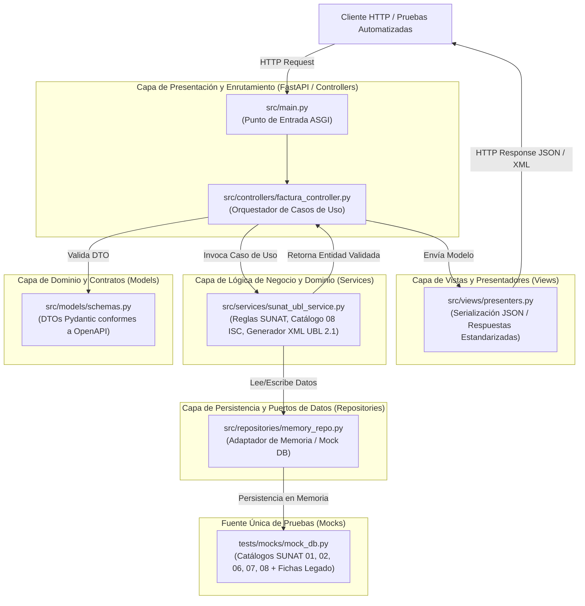
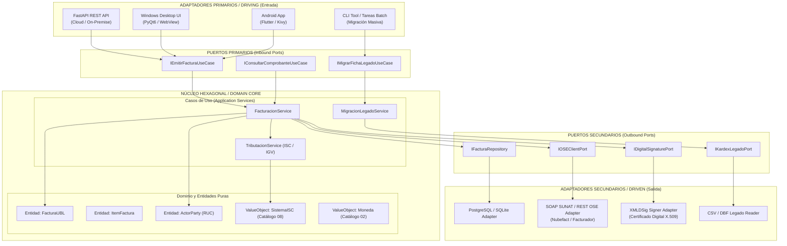

# Documento de Arquitectura de Software
## Proyecto: ABC Software Corp — Sistema de Facturación Electrónica UBL 2.1 y Migración Legado

---

## 1. Arquitectura Actual: MVC Monolítico Desacoplado (Fase 1)

El sistema implementa el patrón **Modelo-Vista-Controlador (MVC) desacoplado**, estructurado de forma que la capa de controladores no accede directamente a la persistencia ni acopla la lógica normativa SUNAT a los endpoints HTTP. Se incorporan capas intermedias de **Servicios (Lógica de Dominio y SUNAT)** y **Repositorios (Acceso a Datos)** que actúan como puertos y adaptadores preliminares.

### Diagrama Mermaid: Arquitectura MVC Limpia Actual



---

## 2. Evolución Futura: Arquitectura Hexagonal (Puertos y Adaptadores)

La estructura actual permite una migración natural hacia **Arquitectura Hexagonal (Ports & Adapters)** sin romper los contratos del dominio. En esta evolución, el núcleo (Core) queda totalmente agnóstico de frameworks (FastAPI, CLI, Desktop) y de detalles de infraestructura (SUNAT SOAP, OSE REST, PostgreSQL, SQLite móvil).

### Diagrama Mermaid: Evolución a Arquitectura Hexagonal y Microservicios



---

## 3. Estrategia de Distribución Multiplataforma (Nativo)

Para cumplir con los requerimientos operativos de **ABC Software Corp**, el sistema se distribuirá tanto para estaciones de trabajo fijas de escritorio (Windows) como para terminales móviles de punto de venta / almacén (Android).

### 3.1. Distribución en Windows: Instalador MSI Nativo

1. **Compilación del Núcleo y Runtime Embebido**:
   - Se utiliza **PyInstaller** o **Briefcase (BeeWare)** para compilar el runtime de Python, el servidor FastAPI (o un ejecutable desacoplado con UI local en PyQt6/PySide6) en un único paquete binario autocontenido.
   - Parámetros clave de PyInstaller:
     ```bash
     pyinstaller --noconsole --onefile --icon=assets/app.ico --add-data "specs;specs" src/main.py
     ```

2. **Generación del Paquete MSI con WiX Toolset v4**:
   - Se genera un instalador estándar `.msi` corporativo mediante el XML declarativo de **WiX Toolset**:
     - **Rutas de Instalación**: `C:\Program Files\ABC Software Corp\Facturacion UBL`.
     - **Acciones Personalizadas (Custom Actions)**: Registro de servicio de Windows (`FacturadorABC_Service`) que levanta el motor ASGI en segundo plano en `localhost:8000` si opera como agente de facturación local.
     - **Accesos Directos**: Creación de accesos directos en Menú Inicio y Escritorio.
     - **Firma de Código**: Firma digital obligatoria con certificado Authenticode EV para evitar advertencias de Windows SmartScreen.
     - **Actualizaciones Silenciosas**: Soporte para directivas de grupo Active Directory (GPO) con `msiexec /i Setup.msi /qn`.

3. **Arquitectura en Windows**:
   - Modo Standalone: Aplicación de escritorio embebida con WebView2 (Microsoft Edge Chromium) apuntando a la interfaz local montada por FastAPI.
   - Modo Agente: Servicio de fondo que escucha llamadas POS locales y emite a SUNAT directamente.

---

### 3.2. Distribución en Android: Paquete APK Nativo

1. **Opciones Tecnológicas**:
   - **Enfoque Híbrido Liviano (Recomendado)**: Frontend en **Flutter** o **Kotlin Multiplatform (KMP)** que consume el API UBL 2.1 desplegado en la nube o en el servidor central de ABC Software Corp.
   - **Enfoque Totalmente Autónomo (Offline First)**: Compilación del motor Python embebido dentro del APK usando **Chaquopy** (Python SDK for Android) o **Python-for-Android (p4a)** con interfaz Kivy/BeeWare.

2. **Pipeline de Construcción del APK/AAB**:
   - Configuración en `build.gradle` (Module: app) con:
     - `minSdkVersion: 26` (Android 8.0) para garantizar compatibilidad con librerías criptográficas modernas de firma digital.
     - `targetSdkVersion: 34` (Android 14).
     - Módulos de almacenamiento local: **Room DB / SQLite** para almacenar fichas de almacén y emitir comprobantes en modo desconectado.
   - Generación de artefactos de release:
     ```bash
     ./gradlew assembleRelease
     ```
   - Firma mediante `apksigner` con Keystore RSA 2048/4096 bits.

3. **Flujo Offline-to-Online para Facturación Móvil**:
   - En ruta o almacén sin señal, el operador genera la preventa o ficha de salida.
   - Al recuperar conectividad (WiFi/4G), la app sincroniza con el endpoint `/api/v1/migracion/fichas-legado` y automáticamente desencadena la emisión formal `/api/v1/facturas` con UBL 2.1 y obtención del CDR de SUNAT.
