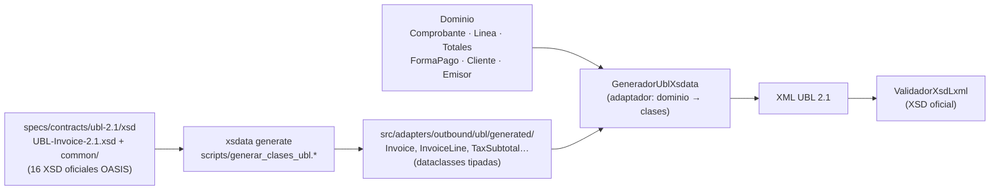

# Taller 2 (segundo parcial): generación del XML a partir de `UBL-Invoice-2.1.xsd`

> **Enunciado.**
> - Describir el caso.
> - Implementación de la generación de XML a partir del XSD Invoice 2.1, en el lenguaje de su dominio.
> - El test serán pruebas unitarias de generación.
> - Fecha límite: 12/11/2026 a la medianoche (se evalúa clonando el repositorio, rama `main`).
>
> **Indicaciones de clase.** Una interfaz pequeña donde se registra una venta (por ejemplo, una motocicleta) y un
> botón "Generar XML" que entrega el archivo `.xml` **sin firma**, validado y aceptado en el OSE-DEMO de Nubefact.

**Respuesta en una línea.** Las clases Python se **generan desde los XSD oficiales** con xsdata. Un adaptador traduce el agregado del dominio (`Comprobante`, `Linea`, `Totales`, `FormaPago`…) a esas clases. El formulario **"Registrar venta"** (`/venta`) lleva una venta al XML con esas mismas reglas, y **118 pruebas unitarias de generación** (más 30 del dominio para el importe en letras y la forma de pago) verifican cada bloque del XML, su conformidad con el XSD y la regresión contra XML de referencia. La factura del caso fue **aceptada por el OSE-DEMO de Nubefact** ([evidencia](evidencia-nubefact/README.md)).

```powershell
uvicorn src.main:app                         # http://localhost:8000/venta  → formulario "Registrar venta"
pytest tests/unit/generacion_xml -v          # 118 pruebas unitarias de generación
python -m src.adapters.inbound.cli generar-xml specs/ejemplos/factura.json --fecha 2026-10-22
```

---

## 0. El caso

**ABC Software Corp** (RUC 20556677884, nombre comercial ABC DISTRIBUCIONES) es una empresa mediana que comercializa abarrotes y mercadería al por mayor y menor. Hoy registra sus ventas en un software básico de almacén que no emite comprobantes electrónicos, no calcula bien los impuestos y no produce el XML que exige SUNAT (RS 097-2012). El análisis completo del caso está en [`analisis/01-caso-brechas-y-riesgos.md`](analisis/01-caso-brechas-y-riesgos.md).

**Caso de estudio de este taller: una venta.** ABC vende **una motocicleta de 150 cc para reparto** a la Distribuidora de Abarrotes El Sol S.A.C. (RUC 20123456786), al contado, por **S/ 5 000.00 con IGV**. El vendedor la registra en el formulario y el sistema produce la factura electrónica en UBL 2.1:

| Paso | Quién | Qué ocurre | Dónde |
|---|---|---|---|
| 1 | Vendedor | Registra la venta: factura, cliente con RUC, producto, cantidad 1, **valor unitario sin IGV 4 237.29**, gravado (Cat. 07 = 10) | Formulario `/venta` |
| 2 | Dominio | Valida las reglas SUNAT (factura → RUC con módulo 11, serie F, fecha del día) y calcula: valor de venta **4 237.29**, IGV 18 % **762.71**, total **5 000.00**, "CINCO MIL CON 00/100 SOLES", forma de pago Contado | `Linea.calcular`, `Totales`, `BorradorComprobante` |
| 3 | Sistema | Asigna el correlativo (el vendedor solo elige la serie) | puerto `SecuenciaCorrelativos` |
| 4 | Generador | Llena las clases del XSD (`Invoice`, `InvoiceLine`, `TaxTotal`…) y serializa el XML **sin firma** | `GeneradorUblXsdata` |
| 5 | Validador | Valida el XML contra `UBL-Invoice-2.1.xsd`. Si no valida, no se entrega | `ValidadorXsdLxml` |
| 6 | Vendedor | Descarga el XML y lo prueba en el OSE-DEMO de Nubefact: **CDR 0, aceptada** | [`evidencia-nubefact/`](evidencia-nubefact/README.md) |

**Reglas del caso que el sistema hace cumplir:**
- factura solo a clientes con RUC;
- boleta (serie B) a personas; si supera **S/ 700**, el cliente debe identificarse con DNI, carné, pasaporte o RUC;
- IGV 18 % sobre el valor de venta en las operaciones gravadas; exonerado (20) e inafecto (30) sin IGV;
- la forma de pago se informa en la factura (RS 193-2020).

**Fuera del alcance de este taller** (según las indicaciones de clase): la firma con certificado real, el envío a SUNAT, la guía de remisión y la consulta de RUC al padrón. La firma XMLDSig y el envío a SUNAT beta ya existen en el proyecto, pero el formulario entrega el XML sin firma por defecto.

## 0.1 El formulario "Registrar venta"

**Para abrirlo basta un doble clic en [`iniciar.bat`](../iniciar.bat)** (o `python iniciar.py`). El lanzador solo usa la biblioteca estándar de Python:
1. la primera vez crea `.venv` e instala `requirements.txt`;
2. levanta el servidor en `127.0.0.1` (si el puerto 8000 está ocupado, usa el siguiente libre);
3. abre el navegador en `/venta`.

Las siguientes veces arranca directo. Se verificó desde una copia limpia del repositorio, sin `.venv`. Sin el lanzador:

```powershell
uvicorn src.main:app        # abrir http://localhost:8000/venta
```

| Parte del formulario | Qué hace |
|---|---|
| **Comprobante** | Factura (01) o boleta (03) y la serie. Cada visita propone una **serie nueva** (F o B + 3 caracteres): el OSE-DEMO de Nubefact es compartido y un número ya usado da el error **1033**. El correlativo es automático |
| **Cliente** | Documento del Catálogo 06 (RUC, DNI, carné, pasaporte o sin documento), número, nombre y dirección |
| **Productos** | Descripción libre, unidad (Cat. 03), cantidad, **valor unitario sin IGV** y afectación (Cat. 07: 10, 20 o 30). El producto no tiene que existir en el inventario |
| **Incluir firma** | Desmarcada: el XML sale **sin firma**, sin `ext:UBLExtensions` (que en el XSD es opcional). No se deja un `ext:ExtensionContent` vacío porque el XSD no lo admite. La raíz `<Invoice>` declara de todos modos los prefijos `ext` y `ds`, como los ejemplos de SUNAT, para que quien firme después (Nubefact con su casilla "Firmar") pueda insertar la firma; sin esa declaración Nubefact responde 0306. Marcada: firma XMLDSig con el certificado de prueba. **Ningún dato del comprobante cambia**: solo la presentación del XML |
| **Generar XML** | Muestra los importes que calculó el dominio, la **matriz** y el XML, con los botones **Descargar XML** y **Copiar XML** |

**La matriz del resultado.** No hay una plantilla XML con huecos. La correspondencia "dato SUNAT → etiqueta UBL" ya existe en la [matriz de trazabilidad](../specs/traceability/matriz-trazabilidad.md). El formulario evalúa cada XPath de esa matriz sobre el XML recién generado y muestra, para la venta concreta, el dato, su catálogo, la etiqueta UBL y el valor que quedó. Por ejemplo, T03 `cbc:ID` = `FM0T-1` y T62 `cac:LegalMonetaryTotal/cbc:PayableAmount` = `5000.00`.

**Si algo no cumple, el XML no se entrega:** el error vuelve al formulario y se marca en su campo. Por ejemplo, una boleta de la moto sin documento del cliente responde *"Las boletas mayores a S/ 700.00 deben identificar al cliente…"* en el campo del documento.

**Cómo encaja en la arquitectura.** El formulario es un adaptador de entrada más, como la API y la línea de comandos:

| Capa | Archivo | Responsabilidad |
|---|---|---|
| Controlador (C de MVC) | [`controladores/venta.py`](../src/adapters/inbound/http/controladores/venta.py) | `GET /venta` y `POST /venta`. No figura en el OpenAPI: es una vista HTML, no parte de la API `/api/v1` |
| Traducción | [`formulario_venta.py`](../src/adapters/inbound/http/formulario_venta.py) | Campos HTML → `GenerarXmlVentaCmd` (`Decimal`, catálogos). No calcula impuestos |
| Vista (V de MVC) | [`vistas/venta.py`](../src/adapters/inbound/http/vistas/venta.py) y [`vistas/matriz_ubl.py`](../src/adapters/inbound/http/vistas/matriz_ubl.py) | HTML hecho en el servidor, sin librerías externas y con cabeceras de seguridad (CSP) |
| Caso de uso | [`casos_uso/venta_xml.py`](../src/application/casos_uso/venta_xml.py) | `GenerarXmlVenta`: mismas reglas del dominio y mismos puertos que la emisión, pero se detiene en el XML (no registra, no mueve el Kardex, no envía) |


## 1. Del XSD a las clases: nada se escribe a mano



- **Las clases salen del XSD.** El XSD es la fuente: `xsdata` produce una dataclass por cada tipo de UBL. La CI vuelve a generarlas y falla si difieren de las versionadas.
- **No hay plantillas ni concatenación.** Por eso el serializador escapa `&`, `<` y `>`, y el orden de los elementos lo impone el XSD. Un elemento que no existe en el XSD ni siquiera se puede construir.
- **Validación con el XSD oficial completo.** El XML se valida con `lxml` antes de firmar y otra vez después de firmar.

## 2. "En el lenguaje del dominio"

El generador **no recibe JSON ni diccionarios**: recibe el agregado `Comprobante`, con los mismos nombres que usa el negocio de ABC. El cálculo (IGV, ISC, ICBPER, totales, cuotas) ya lo hizo el dominio, y el generador **solo traduce**; no calcula nada.

| Término del dominio (`src/domain`) | Elemento UBL 2.1 que genera | Método del generador |
|---|---|---|
| `Comprobante.tipo` (factura/boleta → `Invoice`, nota de crédito → `CreditNote`, nota de débito → `DebitNote`) | elemento raíz + `cbc:InvoiceTypeCode` | `_documento` |
| `Comprobante.numero` (`Serie` + `Correlativo`) | `cbc:ID` (`F001-1`) | `_documento` |
| `Comprobante.tipo_operacion` | `cbc:InvoiceTypeCode/@listID` (Cat. 51) | `_documento` |
| `Comprobante.monto_en_letras` | `cbc:Note[@languageLocaleID='1000']` | `_documento` |
| `Emisor` | `cac:AccountingSupplierParty` | `_emisor` |
| `Cliente` (`DocumentoIdentidad`) | `cac:AccountingCustomerParty` (Cat. 06) | `_cliente` |
| `Linea` | `cac:InvoiceLine` / `CreditNoteLine` / `DebitNoteLine` | `_linea` |
| `Linea.unidad` (`UnidadMedida`) | `cbc:InvoicedQuantity/@unitCode` (Cat. 03) | `_cantidad` |
| `Linea.afectacion` (`AfectacionIGV`) | `cac:TaxCategory/cbc:TaxExemptionReasonCode` (Cat. 07) | `_linea` |
| `Linea.isc` (`ConfiguracionISC`) | `cac:TaxSubtotal[2000]/cac:TaxCategory/cbc:TierRange` (Cat. 08) | `_linea` |
| `Linea.aplica_icbper` | `cac:TaxSubtotal[7152]` con `cbc:BaseUnitMeasure` y `cbc:PerUnitAmount` | `_linea` |
| `Totales` | `cac:TaxTotal` + `cac:LegalMonetaryTotal` (en ND: `RequestedMonetaryTotal`) | `_tributos_documento`, `_totales` |
| `FormaPago` (`Cuota`) | `cac:PaymentTerms` (`FormaPago`: Contado / Credito / Cuota001…) | `_forma_pago` |
| `Comprobante.documentos_legado` | `cac:AdditionalDocumentReference` (Cat. 12, tipo 99) | `_documento` |
| `Comprobante.referencia`, `motivo`, `sustento` | `cac:BillingReference` + `cac:DiscrepancyResponse` (Cat. 09 / 10) | `_documento` |

Código: [`src/adapters/outbound/ubl/generador.py`](../src/adapters/outbound/ubl/generador.py). El generador implementa el puerto `GeneradorUBL` ([`puertos.py`](../src/application/puertos.py)): el caso de uso no sabe que existe xsdata.

## 3. Pruebas unitarias de generación

Están en [`tests/unit/generacion_xml/`](../tests/unit/generacion_xml) y corren sin HTTP ni base de datos.
- **Escenarios del dominio:** parten de objetos construidos por [`fabrica.py`](../tests/unit/generacion_xml/fabrica.py). Son factura al contado, factura al crédito, factura completa (gravado, ISC 01/02/03, ICBPER, exonerado, inafecto), exportación en USD, factura de un vale antiguo, boleta, nota de crédito y nota de débito.
- **Caso de estudio (la motocicleta):** parte del comando que produce el formulario (`GenerarXmlVentaCmd`) y recorre el caso de uso `GenerarXmlVenta` con los adaptadores reales de generación, validación y firma.

La vista web en sí (formulario, errores marcados en su campo, descarga, cabeceras de seguridad) tiene sus pruebas de aceptación en [`tests/acceptance/test_vista_venta.py`](../tests/acceptance/test_vista_venta.py), con memoria y con SQLite.

| Archivo | Qué verifica | Pruebas |
|---|---|---|
| [`test_cabecera.py`](../tests/unit/generacion_xml/test_cabecera.py) | Raíz según el tipo, versión UBL 2.1 y personalización 2.0, `cbc:ID` con correlativo de 8 dígitos, fecha y hora, `InvoiceTypeCode` + Cat. 51, moneda en el documento y en **cada** importe, importe en letras, referencia a la firma | 16 |
| [`test_partes.py`](../tests/unit/generacion_xml/test_partes.py) | RUC, razón social, establecimiento y ubigeo del emisor; cliente con RUC, DNI o no domiciliado; escape de `&` | 6 |
| [`test_lineas.py`](../tests/unit/generacion_xml/test_lineas.py) | Una línea por cada `Linea`, unidad del Cat. 03 por línea (KGM, NIU, ZZ), valor y precio unitario, código de producto, **orden de los elementos según el XSD**, `CreditedQuantity` y `DebitedQuantity` | 8 |
| [`test_tributos.py`](../tests/unit/generacion_xml/test_tributos.py) | IGV (S, 18 %, afectación 10), exonerado (E) e inafecto (O), exportación (G), ISC de los **tres sistemas del Catálogo 08** con su base y su monto, IGV sobre (valor + ISC), ICBPER, cuadre de subtotales por línea y por documento; **reglas 3108 y 3277 de SUNAT** en todos los comprobantes | 28 |
| [`test_totales_pago_y_referencias.py`](../tests/unit/generacion_xml/test_totales_pago_y_referencias.py) | Totales; `RequestedMonetaryTotal` en notas de débito; forma de pago al contado y al crédito con cuotas; vale como documento relacionado tipo 99; referencia y motivo de las notas (Cat. 09 / 10) | 9 |
| [`test_conformidad_y_regresion.py`](../tests/unit/generacion_xml/test_conformidad_y_regresion.py) | Los 8 escenarios **validan contra el XSD oficial**; cualquier texto (`& < > " '`, `]]>`, Ñ, €) produce XML válido; **regresión byte a byte** contra los XML de referencia; determinismo; el `DigestValue` depende solo del contenido | 25 |
| [`test_venta_formulario.py`](../tests/unit/generacion_xml/test_venta_formulario.py) | **El caso de estudio:** la moto da 4237.29 + 762.71 = 5000.00, NIU y afectación 10; producto libre sin inventario; **sin firma no hay `ext:UBLExtensions` y el XML valida contra el XSD**; con firma lleva XMLDSig; sin comentarios antes de `<Invoice>`; correlativo automático; boleta con DNI; se rechazan la boleta de más de S/ 700 sin identificar, la factura a DNI, la serie del otro tipo y las notas; XML indentado una etiqueta por línea, con `ext` y `ds` declarados en la raíz, la firma aún válida y sin tocar el XML compacto de la emisión; la matriz muestra el valor de cada etiqueta | 26 |
| [`test_letras_y_pagos.py`](../tests/unit/test_letras_y_pagos.py) | Importe en letras (0 a millones, apócopes UN y VEINTIÚN) y reglas de la forma de pago | 30 |

### XML de referencia ("golden files")

[`tests/unit/generacion_xml/esperados/`](../tests/unit/generacion_xml/esperados) contiene el XML exacto de cada escenario. Si un cambio altera el XML, la prueba de regresión falla y obliga a revisar la diferencia. Cuando el cambio es intencional, se regeneran con:

```powershell
$env:ACTUALIZAR_ESPERADOS="1"; pytest tests/unit/generacion_xml; Remove-Item Env:ACTUALIZAR_ESPERADOS
```

**Defecto encontrado por estas pruebas.** En las líneas exoneradas e inafectas el IGV se serializaba como `0` en lugar de `0.00`. Se corrigió en el dominio (los importes en cero ahora llevan 2 decimales), y desde entonces se verifica que **ningún importe** de los XML de referencia quede sin dos decimales.

**Defectos encontrados por SUNAT.** Al enviar los XML al servicio beta de SUNAT, la factura con ISC fue rechazada por dos reglas que el XSD no expresa. La regla **3108** exige base × tasa = monto del ISC también en el sistema 02 (monto fijo), así que ahora se informa la tasa equivalente. La regla **3277** exige que la base global del IGV no incluya el ISC. Las dos se corrigieron y quedaron como pruebas en `test_tributos.py`. Después de corregirlas, SUNAT aceptó los siete comprobantes ([evidencia](evidencia-sunat/README.md)).

## 4. Ejecutarlo

```powershell
pip install -r requirements-dev.txt
pytest tests/unit/generacion_xml -v

# Generar XML firmados desde solicitudes JSON, sin levantar el servidor:
python -m src.adapters.inbound.cli generar-xml specs/ejemplos/factura.json specs/ejemplos/factura-credito.json `
       specs/ejemplos/nota-credito.json --salida salida-xml --fecha 2026-10-22
```

Salida esperada:

```text
✓ factura.json → salida-xml\20556677884-01-F001-1.xml  [ACEPTADO]  total 359.90 PEN  hash …
✓ factura-credito.json → salida-xml\20556677884-01-F001-2.xml  [ACEPTADO]  total 247.80 PEN  hash …
✓ nota-credito.json → salida-xml\20556677884-07-FC01-1.xml  [ACEPTADO]  total 49.56 PEN  hash …
```

La línea de comandos ([`cli.py`](../src/adapters/inbound/cli.py)) es un **segundo adaptador de entrada**: usa el mismo caso de uso que la API HTTP. Es la prueba práctica de que el hexágono no depende de FastAPI. El formulario `/venta` es el tercero.

## 5. Cómo encaja con el proyecto corregido

El Taller 2 se apoya en lo que ya exigía la revisión del primer entregable:
- la generación desde clases del XSD, en vez de f-strings;
- el cálculo en el dominio con `Decimal`;
- el puerto `GeneradorUBL`.

Lo que este taller agrega:
- la suite dedicada de generación y su regresión;
- la forma de pago (RS 193-2020) y el importe en letras;
- la línea de comandos.

El resto del flujo (firma XMLDSig, OSE, libros PLE) se documenta en [`specs/architecture/arquitectura.md`](../specs/architecture/arquitectura.md).
