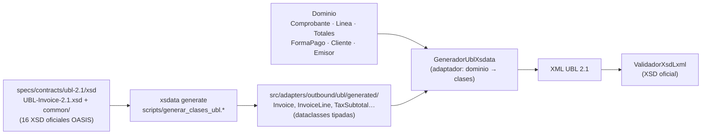

# Taller 2 (segundo parcial): generación del XML a partir de `UBL-Invoice-2.1.xsd`

> **Enunciado.** Implementar la generación de XML a partir del XSD Invoice 2.1, en el lenguaje del dominio. La evaluación serán pruebas unitarias de generación. Fecha límite: 05/11/2026 a medianoche.

**Respuesta en una línea.** Las clases Python se **generan desde los XSD oficiales** con xsdata. Un adaptador traduce el agregado del dominio (`Comprobante`, `Linea`, `Totales`, `FormaPago`…) a esas clases, y **92 pruebas unitarias de generación** (más 30 del dominio para el importe en letras y la forma de pago) verifican cada bloque del XML, su conformidad con el XSD y la regresión contra XML de referencia.

```powershell
pytest tests/unit/generacion_xml -v          # 92 pruebas unitarias de generación
python -m src.adapters.inbound.cli generar-xml specs/ejemplos/factura.json --fecha 2026-10-22
```

---

## 1. Del XSD a las clases: nada se escribe a mano



- **Las clases salen del XSD.** El XSD es la fuente: `xsdata` produce una dataclass por cada tipo de UBL. La CI vuelve a generarlas y falla si difieren de las versionadas.
- **No hay plantillas ni concatenación.** Por eso el serializador escapa `&`, `<` y `>`, y el orden de los elementos lo impone el XSD. Un elemento que no existe en el XSD ni siquiera se puede construir.
- **Validación con el XSD oficial completo.** El XML se valida con `lxml` antes de firmar y otra vez después de firmar.

## 2. "En el lenguaje del dominio"

El generador **no recibe JSON ni diccionarios**: recibe el agregado `Comprobante`, con los mismos nombres que usa el negocio de ABC. El cálculo (IGV, ISC, ICBPER, totales, cuotas) ya lo hizo el dominio, y el generador **solo traduce**; no calcula nada.

| Término del dominio (`src/domain`) | Elemento UBL 2.1 que genera | Método del generador |
|---|---|---|
| `Comprobante.tipo` (factura/boleta → `Invoice`, nota de crédito → `CreditNote`, nota de débito → `DebitNote`) | elemento raíz + `cbc:InvoiceTypeCode` | `_documento` |
| `Comprobante.numero` (`Serie` + `Correlativo`) | `cbc:ID` (`F001-1`) | `_documento` |
| `Comprobante.tipo_operacion` | `cbc:InvoiceTypeCode/@listID` (Cat. 51) | `_documento` |
| `Comprobante.monto_en_letras` | `cbc:Note[@languageLocaleID='1000']` | `_documento` |
| `Emisor` | `cac:AccountingSupplierParty` | `_emisor` |
| `Cliente` (`DocumentoIdentidad`) | `cac:AccountingCustomerParty` (Cat. 06) | `_cliente` |
| `Linea` | `cac:InvoiceLine` / `CreditNoteLine` / `DebitNoteLine` | `_linea` |
| `Linea.unidad` (`UnidadMedida`) | `cbc:InvoicedQuantity/@unitCode` (Cat. 03) | `_cantidad` |
| `Linea.afectacion` (`AfectacionIGV`) | `cac:TaxCategory/cbc:TaxExemptionReasonCode` (Cat. 07) | `_linea` |
| `Linea.isc` (`ConfiguracionISC`) | `cac:TaxSubtotal[2000]/cac:TaxCategory/cbc:TierRange` (Cat. 08) | `_linea` |
| `Linea.aplica_icbper` | `cac:TaxSubtotal[7152]` con `cbc:BaseUnitMeasure` y `cbc:PerUnitAmount` | `_linea` |
| `Totales` | `cac:TaxTotal` + `cac:LegalMonetaryTotal` (en ND: `RequestedMonetaryTotal`) | `_tributos_documento`, `_totales` |
| `FormaPago` (`Cuota`) | `cac:PaymentTerms` (`FormaPago`: Contado / Credito / Cuota001…) | `_forma_pago` |
| `Comprobante.documentos_legado` | `cac:AdditionalDocumentReference` (Cat. 12, tipo 99) | `_documento` |
| `Comprobante.referencia`, `motivo`, `sustento` | `cac:BillingReference` + `cac:DiscrepancyResponse` (Cat. 09 / 10) | `_documento` |

Código: [`src/adapters/outbound/ubl/generador.py`](../src/adapters/outbound/ubl/generador.py). El generador implementa el puerto `GeneradorUBL` ([`puertos.py`](../src/application/puertos.py)): el caso de uso no sabe que existe xsdata.

## 3. Pruebas unitarias de generación

Están en [`tests/unit/generacion_xml/`](../tests/unit/generacion_xml). Todas parten de objetos del dominio construidos por [`fabrica.py`](../tests/unit/generacion_xml/fabrica.py), sin HTTP ni base de datos. Los escenarios son: factura al contado, factura al crédito, factura completa (gravado, ISC 01/02/03, ICBPER, exonerado, inafecto), exportación en USD, factura de un vale antiguo, boleta, nota de crédito y nota de débito.

| Archivo | Qué verifica | Pruebas |
|---|---|---|
| [`test_cabecera.py`](../tests/unit/generacion_xml/test_cabecera.py) | Raíz según el tipo, versión UBL 2.1 y personalización 2.0, `cbc:ID` con correlativo de 8 dígitos, fecha y hora, `InvoiceTypeCode` + Cat. 51, moneda en el documento y en **cada** importe, importe en letras, referencia a la firma | 16 |
| [`test_partes.py`](../tests/unit/generacion_xml/test_partes.py) | RUC, razón social, establecimiento y ubigeo del emisor; cliente con RUC, DNI o no domiciliado; escape de `&` | 6 |
| [`test_lineas.py`](../tests/unit/generacion_xml/test_lineas.py) | Una línea por cada `Linea`, unidad del Cat. 03 por línea (KGM, NIU, ZZ), valor y precio unitario, código de producto, **orden de los elementos según el XSD**, `CreditedQuantity` y `DebitedQuantity` | 8 |
| [`test_tributos.py`](../tests/unit/generacion_xml/test_tributos.py) | IGV (S, 18 %, afectación 10), exonerado (E) e inafecto (O), exportación (G), ISC de los **tres sistemas del Catálogo 08** con su base y su monto, IGV sobre (valor + ISC), ICBPER, cuadre de subtotales por línea y por documento; **reglas 3108 y 3277 de SUNAT** en todos los comprobantes | 28 |
| [`test_totales_pago_y_referencias.py`](../tests/unit/generacion_xml/test_totales_pago_y_referencias.py) | Totales; `RequestedMonetaryTotal` en notas de débito; forma de pago al contado y al crédito con cuotas; vale como documento relacionado tipo 99; referencia y motivo de las notas (Cat. 09 / 10) | 9 |
| [`test_conformidad_y_regresion.py`](../tests/unit/generacion_xml/test_conformidad_y_regresion.py) | Los 8 escenarios **validan contra el XSD oficial**; cualquier texto (`& < > " '`, `]]>`, Ñ, €) produce XML válido; **regresión byte a byte** contra los XML de referencia; determinismo; el `DigestValue` depende solo del contenido | 25 |
| [`test_letras_y_pagos.py`](../tests/unit/test_letras_y_pagos.py) | Importe en letras (0 a millones, apócopes UN y VEINTIÚN) y reglas de la forma de pago | 30 |

### XML de referencia ("golden files")

[`tests/unit/generacion_xml/esperados/`](../tests/unit/generacion_xml/esperados) contiene el XML exacto de cada escenario. Si un cambio altera el XML, la prueba de regresión falla y obliga a revisar la diferencia. Cuando el cambio es intencional, se regeneran con:

```powershell
$env:ACTUALIZAR_ESPERADOS="1"; pytest tests/unit/generacion_xml; Remove-Item Env:ACTUALIZAR_ESPERADOS
```

**Defecto encontrado por estas pruebas.** En las líneas exoneradas e inafectas el IGV se serializaba como `0` en lugar de `0.00`. Se corrigió en el dominio (los importes en cero ahora llevan 2 decimales), y desde entonces se verifica que **ningún importe** de los XML de referencia quede sin dos decimales.

**Defectos encontrados por SUNAT.** Al enviar los XML al servicio beta de SUNAT, la factura con ISC fue rechazada por dos reglas que el XSD no expresa. La regla **3108** exige base × tasa = monto del ISC también en el sistema 02 (monto fijo), así que ahora se informa la tasa equivalente. La regla **3277** exige que la base global del IGV no incluya el ISC. Las dos se corrigieron y quedaron como pruebas en `test_tributos.py`. Después de corregirlas, SUNAT aceptó los siete comprobantes ([evidencia](evidencia-sunat/README.md)).

## 4. Ejecutarlo

```powershell
pip install -r requirements-dev.txt
pytest tests/unit/generacion_xml -v

# Generar XML firmados desde solicitudes JSON, sin levantar el servidor:
python -m src.adapters.inbound.cli generar-xml specs/ejemplos/factura.json specs/ejemplos/factura-credito.json `
       specs/ejemplos/nota-credito.json --salida salida-xml --fecha 2026-10-22
```

Salida esperada:

```text
✓ factura.json → salida-xml\20556677884-01-F001-1.xml  [ACEPTADO]  total 359.90 PEN  hash …
✓ factura-credito.json → salida-xml\20556677884-01-F001-2.xml  [ACEPTADO]  total 247.80 PEN  hash …
✓ nota-credito.json → salida-xml\20556677884-07-FC01-1.xml  [ACEPTADO]  total 49.56 PEN  hash …
```

La línea de comandos ([`cli.py`](../src/adapters/inbound/cli.py)) es un **segundo adaptador de entrada**: usa el mismo caso de uso que la API HTTP. Es la prueba práctica de que el hexágono no depende de FastAPI.

## 5. Cómo encaja con el proyecto corregido

El Taller 2 se apoya en lo que ya exigía la revisión del primer entregable:
- la generación desde clases del XSD, en vez de f-strings;
- el cálculo en el dominio con `Decimal`;
- el puerto `GeneradorUBL`.

Lo que este taller agrega:
- la suite dedicada de generación y su regresión;
- la forma de pago (RS 193-2020) y el importe en letras;
- la línea de comandos.

El resto del flujo (firma XMLDSig, OSE, libros PLE) se documenta en [`specs/architecture/arquitectura.md`](../specs/architecture/arquitectura.md).
