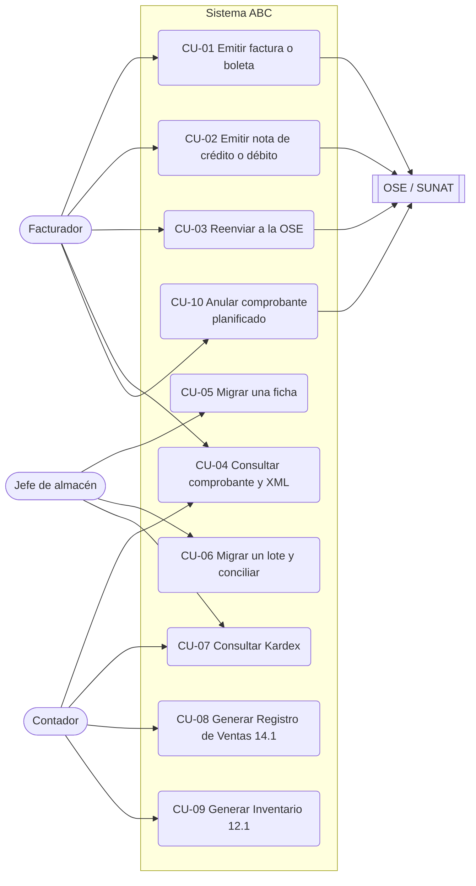

# 3. Casos de uso

## 3.1 Actores

| Actor | Necesidad principal | Alcance del token |
|---|---|---|
| Facturador o cajero | Emitir comprobantes rápido y sin rechazos | `comprobantes:emitir` |
| Jefe de almacén | Registrar y migrar los movimientos del almacén | `inventario:escribir` |
| Contador | Revisar comprobantes, Kardex y libros PLE | `comprobantes:leer`, `inventario:leer`, `libros:leer` |
| OSE / SUNAT (sistema externo) | Recibir el XML firmado y devolver el CDR | — (puerto `ClienteOSE`) |
| Sistema antiguo de almacén (sistema externo) | Origen de las fichas históricas | — (archivo de lote) |

## 3.2 Mapa de casos de uso

## 3.3 Catálogo

La columna **Fuente** dice qué justifica cada caso de uso:

- **E:** enunciado del caso ABC;
- **N:** norma SUNAT;
- **Hx:** hipótesis de la §3.5, que la cuenta DEMO y los usuarios deben confirmar o refutar;
- **B:** [benchmark](05-benchmark.md).

Mientras una hipótesis no se confirme, el caso de uso se justifica solo por E y N.

| CU | Caso de uso | Caso de uso en código | Endpoint | Pruebas | Fuente |
|---|---|---|---|---|---|
| CU-01 | Emitir factura o boleta (contado o crédito) | `EmitirComprobante` | `POST /api/v1/comprobantes` | `TestEmisionFeliz`, `TestSerieYCorrelativo` | E · N (RS 097-2012, RS 193-2020) · H1 · B |
| CU-02 | Emitir nota de crédito o débito | `EmitirComprobante` | `POST /api/v1/comprobantes` | `TestNotas` | N (Catálogos 09 y 10) · H2 · B |
| CU-03 | Reenviar a la OSE un comprobante pendiente | `ReenviarComprobante` | `POST …/{tipo}/{serie_numero}/envios` | `TestOse` | E (sucursales con conexión inestable) · H4 · B |
| CU-04 | Consultar un comprobante y descargar su XML | `ConsultarComprobante` | `GET …/{tipo}/{serie_numero}` y `/xml` | `TestConsulta` | N (conservación del XML y del CDR) |
| CU-05 | Migrar una ficha del sistema antiguo | `MigrarFichaLegado` | `POST /api/v1/inventario/migraciones` | `TestMigracion` | E (fichas `fecha`, `ingreso`, `salida`, `producto`, `nro_documento`) · N (RS 234-2006) |
| CU-06 | Migrar un lote con observaciones y conciliación | `MigrarLoteLegado` | `POST /api/v1/inventario/migraciones/lotes` | `TestLoteDeMigracion` | E · H3 |
| CU-07 | Consultar el Kardex de un producto | `ConsultarKardex` | `GET /api/v1/inventario/kardex/{codigo}` | `TestKardex` | N (RS 234-2006, inventario permanente) |
| CU-08 | Generar el Registro de Ventas 14.1 | `GenerarRegistroVentas141` | `GET /api/v1/libros-electronicos/registro-ventas/{AAAAMM}` | `TestRegistroVentas141` | N (RS 286-2009, Anexo 2) · B |
| CU-09 | Generar el Inventario 12.1 | `GenerarInventario121` | `GET /api/v1/libros-electronicos/inventario-unidades-fisicas/{AAAAMM}` | `TestInventario121` | N (RS 286-2009, Anexo 2) · B |
| CU-10 | Anular un comprobante (comunicación de baja o resumen diario) | **Planificado** ([ADR 0014](../../specs/adr/0014-comunicacion-de-baja-y-resumen-diario.md)) | `POST …/{tipo}/{serie_numero}/bajas` · `POST /api/v1/resumenes-diarios` | Contrato: `test_las_operaciones_planificadas_estan_completas` | N (comunicación de baja y resumen diario) · H5 · B |

**Fuera de alcance de esta versión:**
- implementar CU-10 (su contrato ya está escrito: ADR 0014);
- operaciones gratuitas, anticipos y detracciones;
- representación impresa en PDF;
- formato 13.1 valorizado.

## 3.4 Especificación de los casos críticos

### CU-01 Emitir factura o boleta

- **Precondiciones:** el emisor está configurado; si la línea usa un producto, ese producto existe y tiene stock.
- **Flujo principal:**
  1. El facturador envía la serie, el cliente, las líneas (cantidad, unidad, valor unitario, afectación y, si corresponde, ISC o ICBPER) y la forma de pago.
  2. El sistema valida el contrato (400 si falla).
  3. Calcula los tributos, aplica las reglas SUNAT (422 si falla) y verifica el stock.
  4. Reserva el correlativo.
  5. Genera el XML desde las clases del XSD, lo valida, lo firma y lo vuelve a validar.
  6. Lo envía a la OSE y registra el estado del CDR → **201**.
- **Flujos alternativos:**
  - **A1.** La OSE no responde: el comprobante queda `PENDIENTE_ENVIO` → **202** (luego CU-03).
  - **A2.** Se repite la misma `Idempotency-Key` con el mismo contenido → **200** con el comprobante original.
  - **A3.** La OSE rechaza (CDR 2xxx): el comprobante queda `RECHAZADO` y el Kardex se compensa.
  - **A4.** La factura cita vales migrados: esos vales pasan a FACTURADA y el Kardex no se descuenta dos veces.
- **Postcondición:** el comprobante es inmutable y su `hash_cpe` es el `DigestValue` de la firma.

### CU-06 Migrar un lote y conciliar

- **Flujo principal:**
  1. El jefe de almacén envía el archivo del sistema antiguo tal como está.
  2. El sistema ordena las fichas por fecha.
  3. Para cada ficha: interpreta la fecha, homologa la glosa, clasifica el `nro_documento` según la tabla 10 y registra el movimiento.
  4. Concilia por producto.
  5. Responde **201** con un resumen (migradas, observadas, duplicadas, cuadra).
- **Flujos alternativos:** una regla falla y la ficha queda **OBSERVADA** con su código, pero el lote continúa; una ficha ya migrada queda **DUPLICADA**, así que reprocesar el archivo es seguro.

## 3.5 Descubrimiento con usuarios: lo que falta hacer

El enunciado pide descubrir casos de uso a partir de la opinión de usuarios y de una cuenta DEMO de un proveedor de facturación electrónica (por ejemplo, Nubefact). **Ese trabajo de campo no está hecho en este repositorio.** Para no presentar como hallazgos lo que solo son supuestos, se deja el guion y las hipótesis que hay que confirmar:

**Guion para la cuenta DEMO:**
1. Emitir una factura al crédito con dos cuotas y comparar los campos que pide la DEMO con `FormaPagoEntrada`.
2. Emitir una boleta mayor a S/ 700 sin DNI y anotar cómo la rechaza.
3. Provocar un rechazo (RUC inválido) y comparar el mensaje con nuestro `problem+json`.
4. Revisar qué hace la DEMO cuando la OSE no responde.
5. Descargar el XML de la DEMO y validarlo con `ValidadorXsdLxml`.

**Hipótesis que deben confirmarse con cajeros y contador:**

| ID | Hipótesis | Si se confirma | Estado |
|---|---|---|---|
| H1 | Los cajeros reintentan el envío cuando "no pasa" y generan duplicados | `Idempotency-Key` es imprescindible en el cliente POS | Por verificar |
| H2 | El contador corrige las ventas con notas de crédito por devolución parcial | El motivo 07 y el reingreso al Kardex son prioridad | Por verificar |
| H3 | El almacén anota facturas físicas de proveedores en `nro_documento` | La clasificación `FACTURA_FISICA` evita convertirlas en vales internos | Por verificar |
| H4 | Una sucursal pierde internet varias veces al mes y la caja no puede detener la venta | El 202 `PENDIENTE_ENVIO` y el MSI con API local (ADR 0008) son necesarios | Por verificar |
| H5 | El error más frecuente que obliga a anular una factura es el RUC del adquiriente | La comunicación de baja (CU-10) es prioridad sobre otras funciones pendientes | Por verificar |

**Cómo se registra el trabajo de campo.** Las capturas de la cuenta DEMO van en [`nubefact-demo/`](nubefact-demo/README.md). Cada hallazgo se anota como "confirma Hx" o "refuta Hx" y se actualiza la columna **Estado** de la tabla. La comparación con otras soluciones está en el [benchmark](05-benchmark.md).
