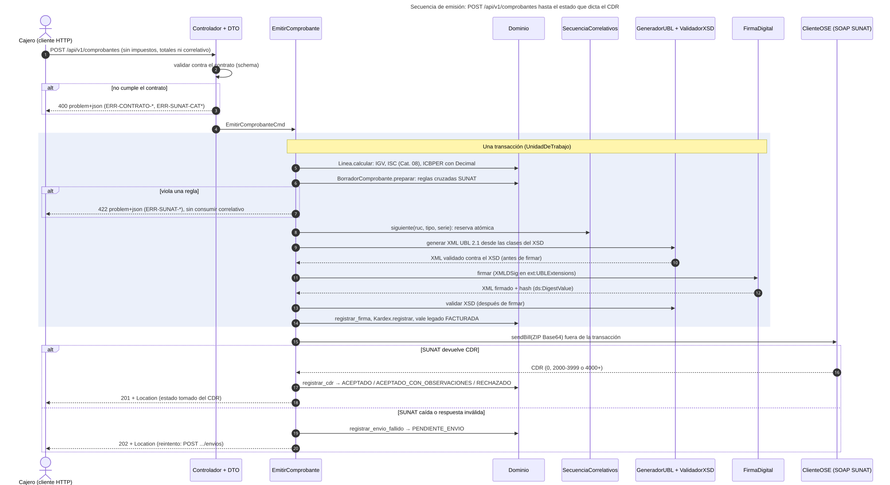

# Resumen ejecutivo

ABC Software Corp es una distribuidora de abarrotes. Debe emitir comprobantes electrónicos válidos ante SUNAT y llevar el inventario permanente en unidades físicas, pero su almacén registra los movimientos en un sistema antiguo de cinco campos (`fecha`, `ingreso`, `salida`, `producto`, `nro_documento`).

Este trabajo especifica primero y construye después un sistema que:

- **emite factura, boleta, nota de crédito y nota de débito** en UBL 2.1. El XML se genera desde las clases del XSD oficial, se valida, se firma y se envía a SUNAT. Los **7 comprobantes del caso fueron aceptados por el servicio beta de SUNAT** (CDR código 0);
- **calcula IGV, ISC (Catálogo 08) e ICBPER en el dominio** con `Decimal`. El cliente nunca envía impuestos ni totales;
- **migra las fichas del sistema antiguo** al Kardex de la RS 234-2006, por lotes, con observaciones y conciliación;
- **genera los libros electrónicos PLE 14.1 y 12.1**. El 12.1 pasó el programa PLE 5.2.0.7 de SUNAT sin inconsistencias.

La metodología es **Spec-First**. El contrato (OpenAPI 3.1 y JSON Schemas 2020-12) se escribe a mano y antes que el código, y la integración continua falla si el código no lo implementa exactamente (ADR 0013). La arquitectura es **hexagonal, con MVC dentro del adaptador HTTP**, y sus reglas de dependencia también se verifican con pruebas.

| Entregable del enunciado | Dónde está en el repositorio |
|---|---|
| 1. Modelo de dominio y contratos | `specs/domain/modelo-dominio.md`, diagrama 06, `specs/contracts/schemas/` |
| 2. Diagramas MVC con visión hexagonal | `docs/diagramas/` (03 a 05), `specs/architecture/arquitectura.md` |
| 3. Contratos API | `specs/contracts/openapi.yaml`, `specs/ejemplos/` |
| 4. Matriz de trazabilidad SUNAT ↔ UBL | `specs/traceability/matriz-trazabilidad.md` |
| Taller 2: generación del XML | `docs/TALLER-2-generacion-xml.md`, `tests/unit/generacion_xml/` |

# Contexto del sistema

El cajero emite comprobantes y el almacenero registra movimientos, también sin conexión. El contador descarga los libros 14.1 y 12.1 y los valida en el programa PLE. SUNAT recibe el XML firmado por SOAP (`sendBill`) y responde con la constancia de recepción (CDR), de la que sale el estado del comprobante.

# Entregable 1: modelo de dominio y contratos

El dominio (`src/domain`) es Python puro, sin frameworks. Sus reglas se expresan como objetos de valor que no pueden existir en un estado inválido:

| Objeto de valor | Invariante | Error |
|---|---|---|
| `Ruc` | 11 dígitos, prefijo 10/15/16/17/20 y dígito verificador módulo 11 | 422 `ERR-SUNAT-RUC` |
| `Serie` | F o B seguida de 3 caracteres alfanuméricos | 422 `ERR-SUNAT-SERIE` |
| `Correlativo` | Entero de 1 a 99 999 999, asignado por el servidor de forma atómica | — |
| `ConfiguracionISC` | 01 exige tasa; 02, monto fijo; 03, tasa y precio de venta al público | 422 `ERR-SUNAT-CAT08` |
| `FormaPago` | Al crédito, la suma de las cuotas iguala el importe total (RS 193-2020) | 422 `ERR-SUNAT-FORMA-PAGO` |

**Contratos de datos (DTO).** Lo que cruza la frontera HTTP está escrito como JSON Schema 2020-12 en `specs/contracts/schemas/`:

- `comprobante-emision.schema.json`: unión de los cuatro comprobantes, discriminada por `tipo_comprobante`;
- `linea.schema.json` y `forma-pago.schema.json`: línea, ISC y forma de pago;
- `ficha-legado.schema.json` y `lote-fichas.schema.json`: migración del sistema antiguo;
- `problema.schema.json`: error RFC 9457;
- `catalogos.schema.json` y `tipos.schema.json`: catálogos SUNAT soportados e importes decimales.

Cada propiedad cita su regla SUNAT y su fila de la matriz. Los DTO de Pydantic del código **implementan** esos schemas, y una prueba compara campos, obligatorios, catálogos, patrones y límites.

# Entregable 2: arquitectura MVC con visión hexagonal

MVC es un patrón de presentación. En la arquitectura hexagonal no desaparece: queda **dentro del adaptador de entrada HTTP**, y el Modelo que consume es el núcleo.

- **Controladores:** traducen HTTP a comandos.
- **Vistas:** producen JSON, XML UBL firmado o el TXT del PLE.
- **Modelo:** los casos de uso y el dominio.

Los puertos son interfaces `typing.Protocol` y cada uno tiene al menos un adaptador real:

- persistencia: memoria y SQLite;
- XML: xsdata + lxml;
- firma: signxml;
- OSE: simulada y SOAP de SUNAT.

`bootstrap.py` es la única raíz de composición. Toda la suite de pruebas de la API corre contra los dos adaptadores de persistencia con el mismo resultado. Es la prueba de que el hexágono funciona.

# Entregable 3: contratos API (Spec-First)

`specs/contracts/openapi.yaml` declara rutas, parámetros, códigos HTTP, seguridad y respuestas, y referencia los JSON Schemas con `$ref`. **Se edita primero.** `tests/acceptance/test_contrato.py` verifica en cada integración:

1. cada ejemplo de `specs/ejemplos/` cumple su schema, y la API lo acepta;
2. **el contrato define qué es 400 y qué es 422**: los contraejemplos que esperan 400 no cumplen el schema, y los que esperan 422 sí lo cumplen (violan una regla de negocio);
3. el código implementa exactamente el contrato, en las dos direcciones. `python scripts/exportar_openapi.py` lista cualquier diferencia.

| Método y ruta | Respuestas |
|---|---|
| `POST /api/v1/comprobantes` | 201 (CDR), 202 (OSE caída), 200 (idempotente), 400, 401, 403, 409, 422 |
| `GET /api/v1/comprobantes/{tipo}/{serie_numero}` y `/xml` | 200, 400, 401, 403, 404 |
| `POST …/{tipo}/{serie_numero}/envios` | 200, 404, 409, 502, 503 con `Retry-After` |
| `POST /api/v1/inventario/migraciones` y `/lotes` | 201, 400, 409, 422 |
| `GET /api/v1/libros-electronicos/registro-ventas/{AAAAMM}` y `/inventario-unidades-fisicas/{AAAAMM}` | 200 (TXT del PLE), 422 |
| **Planificado (ADR 0014):** `POST …/bajas`, `POST /api/v1/resumenes-diarios` | 202 con el ticket de SUNAT |

Todos los errores usan `application/problem+json` (RFC 9457) con un `codigo` estable. La comunicación de baja y el resumen diario están **especificados antes que el código**, con `x-estado: planificado`: si se implementan sin cumplir el contrato, la integración continua falla.

# Entregable 4: matriz de trazabilidad SUNAT ↔ UBL 2.1

La matriz tiene una sola fuente (`specs/traceability/matriz.yaml`) y se publica en Markdown y CSV. Cada fila une el dato normativo con sus ubicaciones:

- el XPath UBL 2.1, con la cardinalidad **calculada desde el XSD**;
- el campo del contrato;
- el campo del sistema antiguo;
- el campo del PLE 14.1 o 12.1;
- el código de error y la prueba.

Extracto:

| ID | Dato | Norma | XPath UBL 2.1 | Contrato | PLE |
|---|---|---|---|---|---|
| T03 | Serie y correlativo | Serie F/B + 3 caracteres | `/Invoice/cbc:ID` | `serie` | 14.1: 7, 8 |
| T27 | Documento del cliente | Cat. 06, módulo 11 | `…/cac:AccountingCustomerParty/…/cbc:ID` | `cliente.numero_documento` | 14.1: 11 |
| T32 | Unidad de medida | Cat. 03 (UN/ECE) | `…/cbc:InvoicedQuantity/@unitCode` | `lineas[].unidad_medida` | 12.1: 16 |
| T40 | Afectación del IGV | Cat. 07 | `…/cac:TaxCategory/cbc:TaxExemptionReasonCode` | `lineas[].afectacion_igv` | 14.1: 13, 14 |
| T43 | Sistema del ISC | Cat. 08 | `…/cac:TaxCategory/cbc:TierRange` | `lineas[].isc.sistema` | — |
| T64 | Forma de pago | RS 193-2020 | `/Invoice/cac:PaymentTerms/cbc:PaymentMeansID` | `forma_pago.tipo` | — |
| T12 | Vale del sistema antiguo | Cat. 12, tipo 99 | `/Invoice/cac:AdditionalDocumentReference/cbc:ID` | `documentos_legado[]` | — |
| T91 | Tipo de operación de inventario | Tabla 12 PLE | — | `tipo_operacion` | 12.1: 14 |

Las pruebas evalúan cada XPath contra XML realmente generados, comprueban cada campo del PLE contra el Anexo 2 oficial y contra el TXT generado, y verifican cada campo del contrato contra el OpenAPI. Ninguna fila queda sin una ubicación verificada.

# Taller 2: generación del XML desde UBL-Invoice-2.1.xsd

Las clases Python se generan desde los XSD oficiales con xsdata; nada se escribe a mano. El adaptador `GeneradorUblXsdata` recibe el agregado del dominio (`Comprobante`, `Linea`, `Totales`, `FormaPago`) y solo traduce: el cálculo ya lo hizo el dominio. Las pruebas unitarias de generación verifican cada bloque del XML, su conformidad con el XSD (antes y después de firmar) y la regresión byte a byte contra XML de referencia.

# Evidencia ante SUNAT

- **Comprobantes.** Los 7 ejemplos del caso se emitieron por la API contra el servicio beta de SUNAT: factura, factura con ISC e ICBPER, factura al crédito, factura de un vale antiguo, boleta, nota de crédito y nota de débito. Todos recibieron **CDR código 0**. El proceso encontró y corrigió dos reglas de SUNAT que el XSD no detecta (3108 y 3277). La evidencia se re-verifica sin red en cada integración y en vivo cada semana.
- **Libros electrónicos.** La estructura de los TXT 14.1 y 12.1 se compara campo por campo con el Excel oficial del Anexo 2 (PLE 5.0). El 12.1 obtuvo la constancia "Reporte de información consistente" del programa PLE 5.2.0.7. El estado del 14.1 se documenta en `docs/evidencia-ple/`.

# Despliegue y distribución

**Servidor.** Imagen Docker que no corre como root, con los datos en el volumen `/datos`. En producción, la configuración exige certificado digital, usuario SOL real y tokens propios.

**Cajas Windows.** MSI construido con PyInstaller + WiX y probado en la integración continua sobre Windows. Es la misma API, local, con SQLite (ADR 0008).

**Almacén.** Aplicación Android en Kotlin nativo, cliente del mismo contrato.

# Atributos de calidad

| Atributo | Escenario | Medida verificada |
|---|---|---|
| Disponibilidad de la venta | El cajero emite con la OSE caída | 202 `PENDIENTE_ENVIO`, reenvío posterior, 0 ventas perdidas |
| Exactitud tributaria | Factura con ISC, ICBPER y exonerados | 0 diferencias entre JSON, XML y 14.1; CDR 0 en SUNAT beta |
| Integridad | Se altera el XML después de firmar | Rechazo 2335 en la OSE simulada y en SUNAT beta |
| Conformidad del contrato | Se cambia un DTO sin cambiar antes el contrato | La integración continua falla |
| Seguridad | Se arranca en producción sin `ABC_API_TOKENS` | El servicio no arranca |

# Límites declarados

- El envío a SUNAT se probó en el servicio beta, que no tiene efecto tributario. Producción usa el mismo adaptador con certificado y usuario SOL reales.
- La comunicación de baja y el resumen diario tienen el contrato escrito, pero no la implementación (ADR 0014).
- No se soportan operaciones gratuitas, anticipos ni detracciones.
- El trabajo de campo con la cuenta DEMO de Nubefact y el benchmark de proveedores están en curso (`docs/analisis/05-benchmark.md`).

# Referencias

- OASIS. *Universal Business Language Version 2.1*. XSD oficiales en `specs/contracts/ubl-2.1/xsd`.
- SUNAT. RS 097-2012/SUNAT y modificatorias (Sistema de Emisión Electrónica) y su Anexo 8 (catálogos).
- SUNAT. RS 193-2020/SUNAT (forma de pago en la factura).
- SUNAT. RS 286-2009/SUNAT y Anexo 2, estructuras PLE 5.0 (libros 14.1 y 12.1).
- SUNAT. RS 234-2006/SUNAT (inventario permanente en unidades físicas).
- IETF. RFC 9457, *Problem Details for HTTP APIs*.
- OpenAPI Initiative. *OpenAPI Specification 3.1* y JSON Schema 2020-12.
- Repositorio del proyecto: https://github.com/Melor-Smith/ARQUITECTURA (ADR 0001 a 0014).
