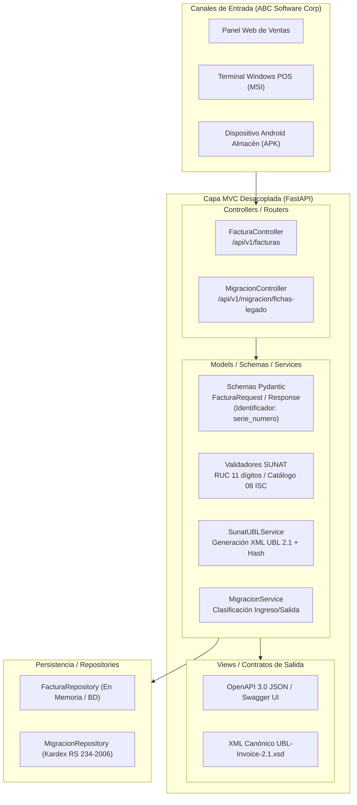

# Especificación de Arquitectura de Software
## Empresa: ABC Software Corp
### Sistema: Facturación Electrónica UBL 2.1 y Migración de Fichas de Almacén
### Patrón Actual: MVC Desacoplado | Patrón Objetivo: Arquitectura Hexagonal (Ports & Adapters)

---

## 1. Visión General de la Arquitectura

Para resolver las problemáticas de **ABC Software Corp** (comercialización de abarrotes al por mayor y menor, dispersión de fichas manuales de almacén y cumplimiento estricto con la RS N° 097-2012 de SUNAT y OASIS UBL-Invoice-2.1.xsd), se diseñó una arquitectura de software desacoplada orientada a especificaciones (**Spec-Driven Development**).

El sistema se estructura en dos fases arquitectónicas:
1. **Fase Actual (MVC Desacoplado en FastAPI)**:
   - **Modelos (M)**: Entidades y esquemas de validación Pydantic que imponen las invariantes de SUNAT (RUC 11 dígitos, Catálogo 08 de ISC, IGV 18%, etc.).
   - **Vistas (V)**: Contratos JSON REST normalizados bajo OpenAPI 3.0 y generadores del árbol canónico XML `UBL-Invoice-2.1.xsd`.
   - **Controladores (C)**: Routers ASGI que orquestan las operaciones de entrada, delegan al dominio y gestionan las respuestas y códigos HTTP normativos.
2. **Fase de Escalado (Arquitectura Hexagonal / Puertos y Adaptadores)**:
   - **Dominio Central**: Lógica pura de cálculo de impuestos, validaciones SUNAT y conciliación de almacén sin dependencias de frameworks.
   - **Puertos de Entrada**: Casos de uso de facturación y migración de inventarios.
   - **Adaptadores Primarios (Driving)**: Endpoints REST FastAPI, CLI de sincronización y eventos por lotes.
   - **Puertos de Salida**: Abstracciones para repositorios de persistencia, generación de XML/Firma digital y clientes SOAP de SUNAT/OSE.
   - **Adaptadores Secundarios (Driven)**: Repositorios en memoria/PostgreSQL, generador de UBL 2.1 y servicios mock/reales de OSE.

---

## 2. Diagrama de Arquitectura MVC Desacoplada

---

## 3. Diagrama de Transición a Arquitectura Hexagonal

```mermaid
graph TD
    subgraph AdaptadoresPrimarios["Adaptadores Primarios (Driving)"]
        A_REST["API FastAPI (Endpoints /api/v1)"]
        A_CLI["CLI de Facturación Masiva (Windows MSI)"]
        A_Mobile["Módulo de Almacén Offline (Android APK)"]
    end

    subgraph PuertosEntrada["Puertos de Entrada (Use Cases)"]
        P_EmitirFactura["IEmitirFacturaUseCase"]
        P_ConsultarFactura["IConsultarFacturaUseCase"]
        P_MigrarKardex["IMigrarKardexUseCase"]
    end

    subgraph DominioCentral["Núcleo de Dominio (Domain Core)"]
        E_Factura["Entidad Factura<br/>serie_numero: F001-000001"]
        E_Item["Entidad Item<br/>Catálogo 08 ISC / IGV 18%"]
        E_Ficha["Entidad FichaAlmacen<br/>RS N° 234-2006"]
        VO_Ruc["Value Object RUC (11 dígitos)"]
        VO_Hash["Value Object HashCPE"]
    end

    subgraph PuertosSalida["Puertos de Salida (Output Ports)"]
        P_RepoFactura["IFacturaRepository"]
        P_RepoKardex["IKardexRepository"]
        P_UBLGenerator["IUBLGeneratorPort"]
        P_OseClient["ISunatOseClientPort"]
    end

    subgraph AdaptadoresSecundarios["Adaptadores Secundarios (Driven)"]
        A_Postgres["Adaptador BD PostgreSQL / SQLite"]
        A_UBL21["Adaptador XML UBL-Invoice-2.1"]
        A_SunatSoap["Adaptador WebService SUNAT/OSE"]
    end

    AdaptadoresPrimarios --> PuertosEntrada
    PuertosEntrada --> DominioCentral
    DominioCentral --> PuertosSalida
    PuertosSalida --> AdaptadoresSecundarios
```

---

## 4. Flujo de Datos Operativo para ABC Software Corp

### Flujo A: Migración de Ficha Informal de Almacén a Comprobante UBL
1. El jefe de almacén ingresa una ficha informal histórica (`fecha`, `salida`, `ingreso`, `producto`, `nro_documento`).
2. El endpoint `POST /api/v1/migracion/fichas-legado` recibe la solicitud.
3. El servicio evalúa la dirección del inventario:
   - Si `salida > 0`: clasifica como `SALIDA_POR_FACTURAR`, genera la correlación formal y sugiere la serie de facturación `F001-XXXXXX`.
   - Si `ingreso > 0`: clasifica como `INGRESO_ALMACEN` y registra el movimiento de stock en el Kardex formal según la RS N° 234-2006 sin deuda de venta.
4. Se garantiza la trazabilidad cruzando `nro_documento` con `cac:DespatchDocumentReference` en la factura electrónica final.

### Flujo B: Emisión Formal de Factura Electrónica
1. El sistema de ventas envía el payload JSON validado según el contrato `ubl-invoice-api.yaml`.
2. Se valida rigurosamente:
   - Identificador `serie_numero` conforme a la regla SUNAT (`^F\d{3}-\d{1,8}$`).
   - RUC de emisor y receptor (11 dígitos, tipo `6` del Catálogo 06).
   - Impuesto Selectivo al Consumo según el **Catálogo 08 de SUNAT** (`01` al valor, `02` monto fijo, `03` precio venta público).
3. Se construye el documento XML conforme a `UBL-Invoice-2.1.xsd`.
4. Se calcula el **Hash CPE** (SHA-256) sobre la estructura del comprobante.
5. Se responde con estado `ACEPTADO`, código 201 y el XML UBL listo para el envío al OSE o SUNAT.

---

## 5. Estrategia de Distribución Nativa Multiplataforma

### Windows Desktop (Instalador MSI)
* **Objetivo**: Terminales fijas de punto de venta (POS) y oficinas administrativas de ABC Software Corp.
* **Empaquetado**: Binario autocontenido generado con PyInstaller.
* **Instalador**: Generado mediante **WiX Toolset v4** en formato `.msi`.
* **Características**: Instalación limpia, soporte para actualizaciones silenciosas GPO de Active Directory corporativo, y ejecución en segundo plano como servicio local de Windows.

### Android Mobile (Paquete APK)
* **Objetivo**: Terminales móviles rugerizadas de almaceneros y transportistas de reparto.
* **Empaquetado**: Aplicación nativa en Flutter/Kotlin con motor Python embebido mediante Chaquopy o cliente ligero REST.
* **Características**: Base de datos SQLite local cifrada (SQLCipher) para operación offline, sincronización automática con el servidor central al recuperar conectividad y escaneo de códigos de barra para fichas de almacén.
