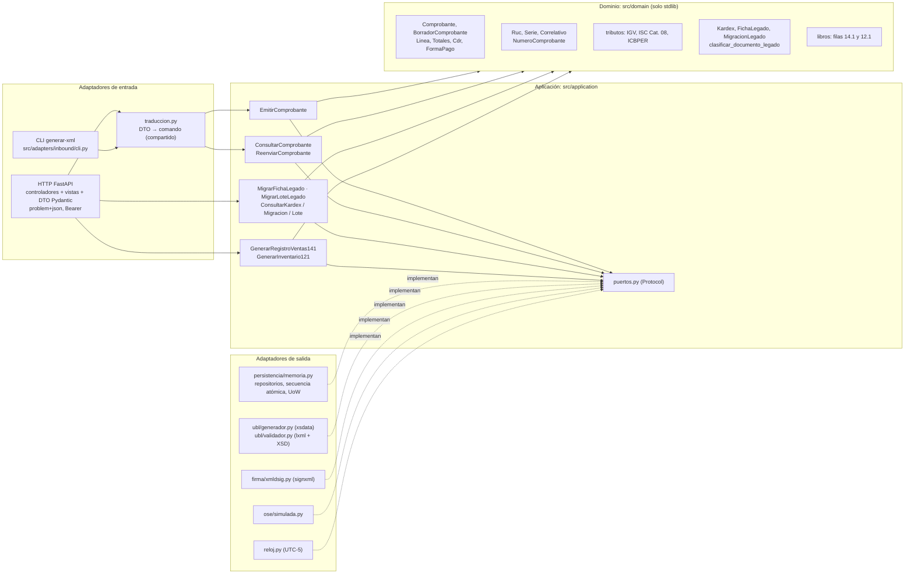
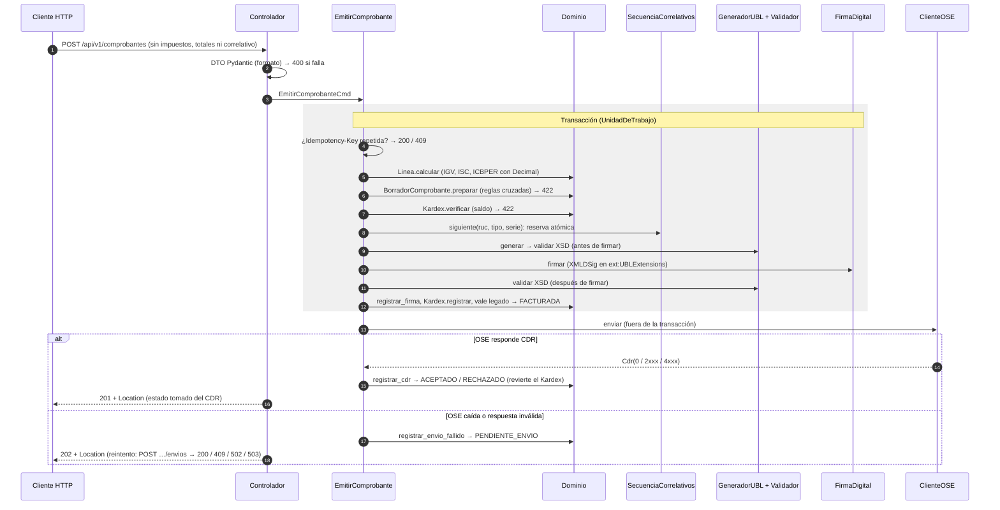
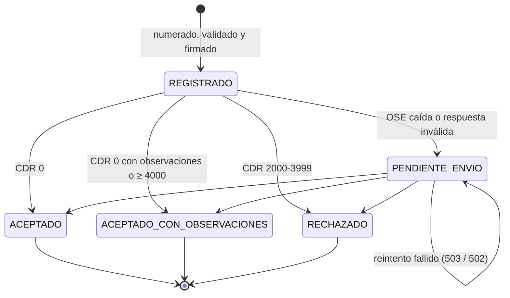
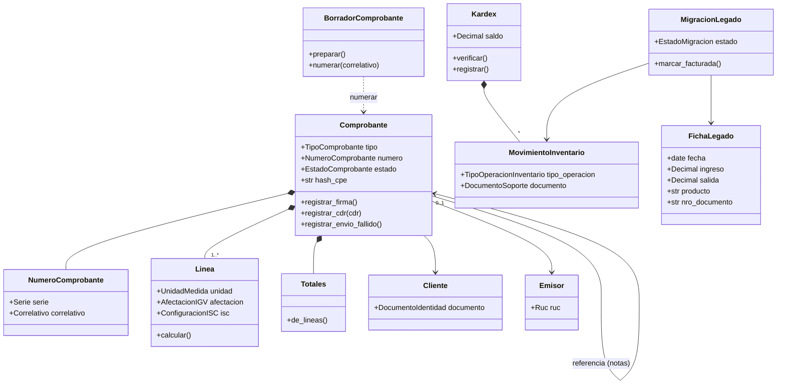

# Arquitectura: de MVC a Hexagonal (Puertos y Adaptadores)

Este documento describe **lo que está implementado**. Cada caja de los diagramas es un módulo que existe en `src/`, y las reglas de dependencia se verifican con pruebas automáticas (`tests/integration/test_arquitectura.py`).

## 1. Por qué la versión anterior no era migrable

| Síntoma | Consecuencia |
|---|---|
| `src/services` importaba de `tests/mocks` | Producción dependía de los datos de prueba |
| Servicios con `@classmethod` que llamaban al repositorio concreto | Sin puntos de inyección: imposible cambiar la memoria por una base de datos o la OSE simulada por la real |
| El "Modelo" eran DTOs de Pydantic | La regla de negocio quedaba atada al framework web y no había entidades con comportamiento |
| La "Vista" era el YAML de OpenAPI | Se confundía el **contrato** con la **representación** |
| Los puertos solo existían en el diagrama | El diagrama hexagonal no tenía correlato en el código |

## 2. Dónde vive MVC ahora

MVC es un patrón de **presentación**. En una arquitectura hexagonal no desaparece: queda **dentro del adaptador de entrada HTTP**, y el "Modelo" que consume es el núcleo de la aplicación.

| MVC | Implementación | Responsabilidad |
|---|---|---|
| **Controlador** | [`adapters/inbound/http/controladores/`](../../src/adapters/inbound/http/controladores) | Traduce HTTP ↔ comando, invoca el caso de uso y elige la vista. Sin reglas de negocio |
| **Modelo** | [`application/`](../../src/application) (casos de uso) y [`domain/`](../../src/domain) (entidades y reglas) | Toda la lógica: cálculo tributario, reglas SUNAT, Kardex, máquina de estados |
| **Vista** | [`adapters/inbound/http/vistas/`](../../src/adapters/inbound/http/vistas) | Representaciones del modelo: **JSON**, **XML UBL firmado** y **TXT del PLE** |
| *(contrato, no vista)* | [`specs/contracts/openapi.yaml`](../contracts/openapi.yaml) | Describe las vistas y las entradas; se genera desde los DTO |

## 3. Hexágono implementado

**Regla de dependencias** (las flechas apuntan hacia adentro):

- `domain` solo importa la biblioteca estándar y `src.domain`.
- `application` importa `domain` y sus propios módulos.
- Los adaptadores importan `application` y `domain`.
- **Ningún** módulo de `src/` importa de `tests/`.

La raíz de composición [`src/bootstrap.py`](../../src/bootstrap.py) es el único lugar que conoce las clases concretas.

**Dos adaptadores de entrada, un solo núcleo.** La API HTTP y la línea de comandos (`python -m src.adapters.inbound.cli generar-xml …`, del Taller 2) traducen el mismo contrato con [`traduccion.py`](../../src/adapters/inbound/traduccion.py) y ejecutan el **mismo** caso de uso `EmitirComprobante`. Agregar un canal (escritorio MSI, app APK) es agregar un adaptador, no tocar las reglas.

### Puertos de salida

| Puerto (`application/puertos.py`) | Adaptador actual | Adaptador de producción (mismo puerto) |
|---|---|---|
| `RepositorioComprobantes`, `RepositorioKardex`, `RepositorioMigraciones`, `RepositorioProductos`, `RepositorioIdempotencia`, `RepositorioLotes` | `persistencia/memoria.py` | PostgreSQL (restricción `UNIQUE` por número) o SQLite en Android |
| `SecuenciaCorrelativos` | `SecuenciaCorrelativosEnMemoria` (con bloqueo) | `UPDATE serie SET ultimo = ultimo + 1 … RETURNING ultimo` |
| `UnidadDeTrabajo` | `RLock` | Transacción SQL |
| `GeneradorUBL` | `GeneradorUblXsdata` | — (es definitivo) |
| `ValidadorEsquemaUBL` | `ValidadorXsdLxml` | — |
| `FirmaDigital` | `FirmaXmlDsig` con certificado autofirmado | `FirmaXmlDsig` con el `.pfx` del emisor |
| `ClienteOSE` | `OseSimulada` | Cliente SOAP `sendBill` de SUNAT o REST de la OSE |
| `Reloj` | `RelojSistema` / `RelojFijo` | — |

## 4. Flujo de emisión

Decisiones clave del flujo:

- **Todas las reglas se validan antes de reservar el correlativo.** Un 422 no deja huecos en la numeración.
- **El envío a la OSE va fuera de la transacción.** Es E/S remota, puede tardar, y no debe bloquear otras emisiones.

## 5. Máquina de estados del comprobante

Cualquier intento de reenviar un comprobante que ya tiene CDR responde 409 (`ERR-COMPROBANTE-YA-PROCESADO`).

## 6. Modelo de dominio

## 7. Correspondencia con la versión anterior

| Antes | Ahora |
|---|---|
| `src/models/schemas.py` (DTO usado como modelo) | Dominio en `src/domain/*`; DTO en `adapters/inbound/http/esquemas.py` |
| `src/services/sunat_ubl_service.py` (estático, f-strings) | Casos de uso en `application/casos_uso/*`; XML en `adapters/outbound/ubl/*`; firma en `adapters/outbound/firma` |
| `src/repositories/memory_repo.py` → `tests/mocks` | `adapters/outbound/persistencia/memoria.py` + `semillas.py`, inyectados |
| `src/controllers/factura_controller.py` | `adapters/inbound/http/controladores/*` |
| `src/views/presenters.py` | `adapters/inbound/http/vistas/*` (JSON, XML, TXT) |
| `specs/contracts/ubl-invoice-api.yaml` (a mano, divergente) | `specs/contracts/openapi.yaml` (generado y verificado) |

## 8. Distribución

La estrategia MSI (Windows, puntos de venta) y APK (Android, almacén sin conexión) se mantiene en el [ADR 0008](../adr/0008-distribucion-msi-y-apk.md). La arquitectura hexagonal es lo que la hace viable: el mismo `domain` + `application` se empaqueta con otros adaptadores de entrada (UI de escritorio, app móvil) y de salida (SQLite local, cola de sincronización), sin tocar las reglas.
